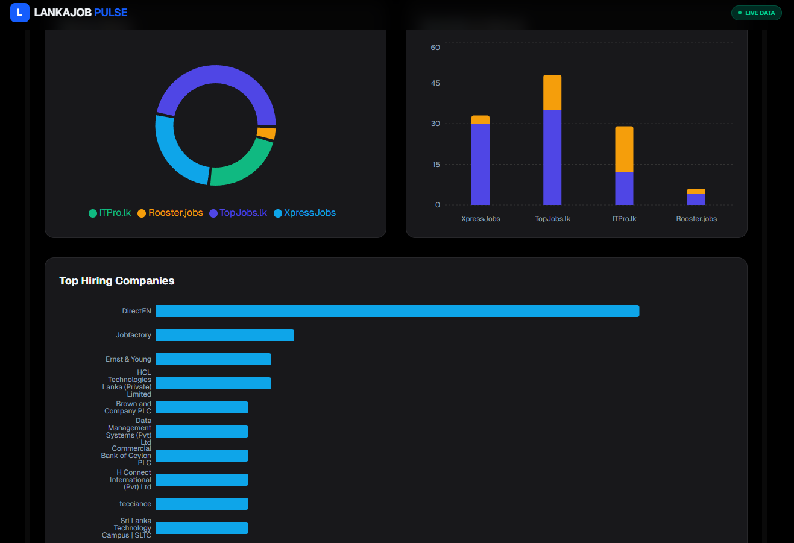
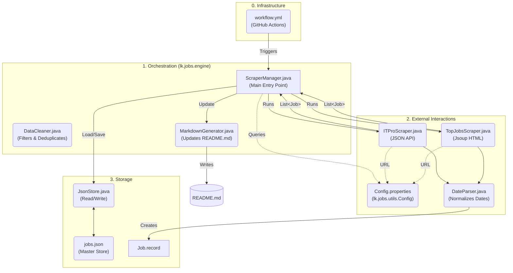

# 🇱🇰 Sri Lanka Software Engineering Jobs | 2026 Tracker [](https://t.me/SL_Software_Jobs)
Looking for software engineering jobs in Sri Lanka? This tracker updates daily with intern, junior, and senior IT roles across Colombo and beyond
Automated Software Engineering Job Tracker for Sri Lanka. Scrapes and categorizes Intern, Associate, and SE roles daily using Java (Jsoup) and GitHub Actions.

> [!TIP]
> **Help keep this project alive!** If this tool helped you find a lead today, please [**Star ⭐ the repo**](https://github.com/Senadeera-NK/sri-lanka-software-jobs). It’s how I measure the impact on our dev community! 🇱🇰

> [!IMPORTANT]
> **Automatic Staleness Purge:** The engine automatically removes listings older than **14 days**, ensuring the feed stays relevant and high-signal.

> **Live Analytics & Daily Software Job Tracker for Sri Lanka**

[📊 View Live Dashboard](https://sri-lanka-software-jobs.vercel.app/)

 
*Click the link above to see real-time trends, seniority distribution, and top hiring companies.*

## 📊 Current Job Openings
> 🟢 **Last Updated:** November 7,5:22 PM (Just now)  | **Total Jobs Found:** 69

### 🎓 Internships & Trainees  (6)

| Title | Company | Level  | Posted | Source |
| :--- | :--- | :--- | :--- | :--- |
| [Intern - Software Engineering](https://rooster.jobs/jobs/520044) | Zegates International Private Limited | Intern | 5&nbsp;days&nbsp;ago | Rooster.jobs |
| [QA Interns](https://www.topjobs.lk/employer/JobAdvertismentServlet?ac=DEFZZZ&jc=0001566545&ec=DEFZZZ) | Fetchseed (Pvt) Ltd | Intern | 5&nbsp;days&nbsp;ago | TopJobs.lk |
| [Intern - Content Developer](https://www.topjobs.lk/employer/JobAdvertismentServlet?ac=DEFZZZ&jc=0001566107&ec=DEFZZZ) | Zuse Technologies (Pvt) Ltd | Intern | 8&nbsp;days&nbsp;ago | TopJobs.lk |
| [Technical Data Processing Intern](https://www.topjobs.lk/employer/JobAdvertismentServlet?ac=DEFZZZ&jc=0001566022&ec=DEFZZZ) | North Sails Sri Lanka | Intern | 8&nbsp;days&nbsp;ago | TopJobs.lk |
| [Intern - Internal Development (2)](https://www.topjobs.lk/employer/JobAdvertismentServlet?ac=0000000311&jc=0001565148&ec=0000000410) | Deloitte | Intern | 10&nbsp;days&nbsp;ago | TopJobs.lk |
| [Software Engineering Intern](https://itpro.lk/job/15582/software-engineering-intern-at-infora-tech/) | Infora Tech | Intern | 12&nbsp;days&nbsp;ago | ITPro.lk |

---

### 💻 Associate & Junior/SE Roles  (40)

| Title | Company | Level  | Posted | Source |
| :--- | :--- | :--- | :--- | :--- |
| [Backend Software Engineer](https://www.topjobs.lk/employer/JobAdvertismentServlet?ac=DEFZZZ&jc=0001565563&ec=DEFZZZ) | Hexacorp SL (Private) Limited | Junior/SE | Yesterday | TopJobs.lk |
| [Data Engineer](https://www.topjobs.lk/employer/JobAdvertismentServlet?ac=DEFZZZ&jc=0001566171&ec=DEFZZZ) | ORYSYS Limited | Junior/SE | Yesterday | TopJobs.lk |
| [Information Security Engineer (1)](https://www.topjobs.lk/employer/JobAdvertismentServlet?ac=0000000271&jc=0001539697&ec=0000000350) | CMS (Pvt) Ltd | Junior/SE | Yesterday | TopJobs.lk |
| [Data Engineer (1)](https://www.topjobs.lk/employer/JobAdvertismentServlet?ac=0000000376&jc=0001568602&ec=0000000493) | Assetline Finance PLC | Junior/SE | Yesterday | TopJobs.lk |
| [Trainee Software Engineer](https://www.topjobs.lk/employer/JobAdvertismentServlet?ac=DEFZZZ&jc=0001568384&ec=DEFZZZ) | Hedanship Asia (Pvt) Ltd | Associate | Yesterday | TopJobs.lk |
| [Business Analyst cum Software Quality Assurance Engineer](https://www.topjobs.lk/employer/JobAdvertismentServlet?ac=DEFZZZ&jc=0001568083&ec=DEFZZZ) | "Company Name With held" | Junior/SE | 2&nbsp;days&nbsp;ago | TopJobs.lk |
| [QA Engineer](https://www.topjobs.lk/employer/JobAdvertismentServlet?ac=DEFZZZ&jc=0001567982&ec=DEFZZZ) | Koombiyo Delivery (Pvt) Ltd | Junior/SE | 2&nbsp;days&nbsp;ago | TopJobs.lk |
| [AI Engineer (Application Development Focus)](https://www.topjobs.lk/employer/JobAdvertismentServlet?ac=DEFZZZ&jc=0001567934&ec=DEFZZZ) | Asiawise Lanka (Pvt) Ltd | Junior/SE | 2&nbsp;days&nbsp;ago | TopJobs.lk |
| [Java Software Engineer](https://www.topjobs.lk/employer/JobAdvertismentServlet?ac=DEFZZZ&jc=0001567746&ec=DEFZZZ) | LAUGFS Eco Sri Ltd | Junior/SE | 3&nbsp;days&nbsp;ago | TopJobs.lk |
| [Executive - BI & AI Engineer](https://www.topjobs.lk/employer/JobAdvertismentServlet?ac=DEFZZZ&jc=0001567720&ec=DEFZZZ) | Dart Global Logistics | Junior/SE | 3&nbsp;days&nbsp;ago | TopJobs.lk |
| [Web Developer](https://www.topjobs.lk/employer/JobAdvertismentServlet?ac=DEFZZZ&jc=0001567638&ec=DEFZZZ) | Damro | Junior/SE | 3&nbsp;days&nbsp;ago | TopJobs.lk |
| [Software Engineer](https://www.topjobs.lk/employer/JobAdvertismentServlet?ac=DEFZZZ&jc=0001567410&ec=DEFZZZ) | Sri Lanka Insurance General | Junior/SE | 3&nbsp;days&nbsp;ago | TopJobs.lk |
| [Experienced React Native Mobile App Developer](https://www.topjobs.lk/employer/JobAdvertismentServlet?ac=DEFZZZ&jc=0001561563&ec=DEFZZZ) | Nascent Grow (Pvt) Ltd | Junior/SE | 4&nbsp;days&nbsp;ago | TopJobs.lk |
| [Software Engineer - Frontend](https://www.topjobs.lk/employer/JobAdvertismentServlet?ac=DEFZZZ&jc=0001567242&ec=DEFZZZ) | InSync Information Technologies Pvt Ltd | Junior/SE | 4&nbsp;days&nbsp;ago | TopJobs.lk |
| [Full Stack Developer (Java & React)](https://www.topjobs.lk/employer/JobAdvertismentServlet?ac=DEFZZZ&jc=0001567162&ec=DEFZZZ) | Fortunaglobal (Pvt) Limited | Junior/SE | 4&nbsp;days&nbsp;ago | TopJobs.lk |
| [Cloud Engineer - UAE (1)](https://www.topjobs.lk/employer/JobAdvertismentServlet?ac=0000000049&jc=0001566708&ec=0000000313) | John Keells IT | Junior/SE | 5&nbsp;days&nbsp;ago | TopJobs.lk |
| [Full Stack Mobile App Developer (Flutter + Node.js)](https://www.topjobs.lk/employer/JobAdvertismentServlet?ac=DEFZZZ&jc=0001566670&ec=DEFZZZ) | Ceylon Institute of Software Enginnering and Law | Junior/SE | 5&nbsp;days&nbsp;ago | TopJobs.lk |
| [Associate Data Analyst - Data Compliance](https://www.topjobs.lk/employer/JobAdvertismentServlet?ac=DEFZZZ&jc=0001561356&ec=DEFZZZ) | Affixcon Pty Ltd | Associate | 6&nbsp;days&nbsp;ago | TopJobs.lk |
| [AI Developer](https://www.topjobs.lk/employer/JobAdvertismentServlet?ac=DEFZZZ&jc=0001566183&ec=DEFZZZ) | CSG Technologies | Junior/SE | 8&nbsp;days&nbsp;ago | TopJobs.lk |
| [Executive - Business Data Analyst (Male) - Boralesgamuwa](https://www.topjobs.lk/employer/JobAdvertismentServlet?ac=DEFZZZ&jc=0001565702&ec=DEFZZZ) | Company Name Withheld | Junior/SE | 8&nbsp;days&nbsp;ago | TopJobs.lk |
| [Data & Analytics Engineer (AUS Calendar - AUS Shift) (1)](https://www.topjobs.lk/employer/JobAdvertismentServlet?ac=0000000064&jc=0001565823&ec=0000000445) | H Connect International (Pvt) Ltd | Junior/SE | 8&nbsp;days&nbsp;ago | TopJobs.lk |
| [Platform & Integration Engineer (AUS Calendar - AUS Shift) (1)](https://www.topjobs.lk/employer/JobAdvertismentServlet?ac=0000000064&jc=0001565844&ec=0000000445) | H Connect International (Pvt) Ltd | Junior/SE | 8&nbsp;days&nbsp;ago | TopJobs.lk |
| [Automation Engineer (AUS Calendar - AUS Shift) (1)](https://www.topjobs.lk/employer/JobAdvertismentServlet?ac=0000000064&jc=0001565828&ec=0000000445) | H Connect International (Pvt) Ltd | Junior/SE | 8&nbsp;days&nbsp;ago | TopJobs.lk |
| [Sharepoint Developer](https://www.topjobs.lk/employer/JobAdvertismentServlet?ac=DEFZZZ&jc=0001565581&ec=DEFZZZ) | Global Sports Lanka (Pvt) Ltd | Junior/SE | 9&nbsp;days&nbsp;ago | TopJobs.lk |
| [DevOps Engineer](https://www.topjobs.lk/employer/JobAdvertismentServlet?ac=DEFZZZ&jc=0001565503&ec=DEFZZZ) | InSync Technologies | Junior/SE | 9&nbsp;days&nbsp;ago | TopJobs.lk |
| [Full Stack Web Developer](https://www.topjobs.lk/employer/JobAdvertismentServlet?ac=DEFZZZ&jc=0001560042&ec=DEFZZZ) | XERO Lanka Pvt Ltd | Junior/SE | 9&nbsp;days&nbsp;ago | TopJobs.lk |
| [Full Stack AI Engineer (React/Node/TypeScript/LLMs)](https://rooster.jobs/jobs/520009) | Nextjob | Junior/SE | 10&nbsp;days&nbsp;ago | Rooster.jobs |
| [Junior Executive - Database Administrator (1)](https://www.topjobs.lk/employer/JobAdvertismentServlet?ac=0000000062&jc=0001565071&ec=0000000714) | Softlogic Finance PLC | Junior/SE | 10&nbsp;days&nbsp;ago | TopJobs.lk |
| [Cloud Engineer - UAE](https://www.topjobs.lk/employer/JobAdvertismentServlet?ac=DEFZZZ&jc=0001564967&ec=DEFZZZ) | SevenX Lanka (Pvt) Ltd | Junior/SE | 10&nbsp;days&nbsp;ago | TopJobs.lk |
| [Security Architect (1)](https://www.topjobs.lk/employer/JobAdvertismentServlet?ac=0000000419&jc=0001564863&ec=0000000552) | Micronet Global Services (Pvt) Ltd | Junior/SE | 10&nbsp;days&nbsp;ago | TopJobs.lk |
| [Associate Cyber Security Engineer](https://www.topjobs.lk/employer/JobAdvertismentServlet?ac=DEFZZZ&jc=0001564720&ec=DEFZZZ) | MintHRM | Associate | 10&nbsp;days&nbsp;ago | TopJobs.lk |
| [Software Engineer](https://itpro.lk/job/15602/software-engineer-at-asia-securities/) | Asia Securities | Junior/SE | 11&nbsp;days&nbsp;ago | ITPro.lk |
| [SQL Database Administrator (1)](https://www.topjobs.lk/employer/JobAdvertismentServlet?ac=0000000271&jc=0001533299&ec=0000000350) | CMS (Pvt) Ltd | Junior/SE | 11&nbsp;days&nbsp;ago | TopJobs.lk |
| [Data Platform Engineer (1)](https://www.topjobs.lk/employer/JobAdvertismentServlet?ac=0000000271&jc=0001533297&ec=0000000350) | CMS (Pvt) Ltd | Junior/SE | 11&nbsp;days&nbsp;ago | TopJobs.lk |
| [Information Security Analyst (1)](https://www.topjobs.lk/employer/JobAdvertismentServlet?ac=0000000271&jc=0001532706&ec=0000000350) | CMS (Pvt) Ltd | Junior/SE | 11&nbsp;days&nbsp;ago | TopJobs.lk |
| [SEO Specialist - Experienced in AI (UAE Based)](https://www.topjobs.lk/employer/JobAdvertismentServlet?ac=DEFZZZ&jc=0001561683&ec=DEFZZZ) | Farhat Office & Co. LLC | Junior/SE | 11&nbsp;days&nbsp;ago | TopJobs.lk |
| [AI \| ML Engineer](https://www.topjobs.lk/employer/JobAdvertismentServlet?ac=DEFZZZ&jc=0001564649&ec=DEFZZZ) | SLIIT Non-Academic | Junior/SE | 11&nbsp;days&nbsp;ago | TopJobs.lk |
| [Full Stack Developer - Trainee](https://itpro.lk/job/14928/full-stack-developer-trainee-at-enhanzer/) | Enhanzer | Associate | 12&nbsp;days&nbsp;ago | ITPro.lk |
| [Shopify Developer (with Word Press Experience) (Remote)](https://www.topjobs.lk/employer/JobAdvertismentServlet?ac=DEFZZZ&jc=0001563895&ec=DEFZZZ) | Asiawise Lanka (Pvt) Ltd | Junior/SE | 12&nbsp;days&nbsp;ago | TopJobs.lk |
| [Full - Stack Engineer - Java & React](https://www.topjobs.lk/employer/JobAdvertismentServlet?ac=0000000494&jc=0001563744&ec=0000000666) | Acentura Pvt Ltd | Junior/SE | 13&nbsp;days&nbsp;ago | TopJobs.lk |

---

### 🚀 Senior & Lead Roles  (23)

| Title | Company | Level  | Posted | Source |
| :--- | :--- | :--- | :--- | :--- |
| [Senior UI \| UX Engineer (Full Time \| On Site)](https://www.topjobs.lk/employer/JobAdvertismentServlet?ac=DEFZZZ&jc=0001563256&ec=DEFZZZ) | Treinetic (Pvt) Ltd | Senior | Yesterday | TopJobs.lk |
| [Teach Lead - Machine Learning (ML)](https://www.topjobs.lk/employer/JobAdvertismentServlet?ac=DEFZZZ&jc=0001566151&ec=DEFZZZ) | ORYSYS Limited | Senior | Yesterday | TopJobs.lk |
| [Tech Lead - AI](https://www.topjobs.lk/employer/JobAdvertismentServlet?ac=DEFZZZ&jc=0001566135&ec=DEFZZZ) | ORYSYS Limited | Senior | Yesterday | TopJobs.lk |
| [Tech Lead - AI Solutions](https://www.topjobs.lk/employer/JobAdvertismentServlet?ac=DEFZZZ&jc=0001566076&ec=DEFZZZ) | ORYSYS Limited | Senior | Yesterday | TopJobs.lk |
| [Senior Data Engineer](https://www.topjobs.lk/employer/JobAdvertismentServlet?ac=DEFZZZ&jc=0001566165&ec=DEFZZZ) | ORYSYS Limited | Senior | Yesterday | TopJobs.lk |
| [Senior Application Security Engineer (1)](https://www.topjobs.lk/employer/JobAdvertismentServlet?ac=0000000271&jc=0001562903&ec=0000000350) | CMS (Pvt) Ltd | Senior | Yesterday | TopJobs.lk |
| [Senior Software Engineer](https://www.topjobs.lk/employer/JobAdvertismentServlet?ac=DEFZZZ&jc=0001568547&ec=DEFZZZ) | Company Name Withheld | Senior | Yesterday | TopJobs.lk |
| [Senior DevOps Engineer](https://www.topjobs.lk/employer/JobAdvertismentServlet?ac=DEFZZZ&jc=0001568397&ec=DEFZZZ) | Mobitel (Pvt) Ltd | Senior | Yesterday | TopJobs.lk |
| [Senior Software Engineer - . NET (1)](https://www.topjobs.lk/employer/JobAdvertismentServlet?ac=0000000375&jc=0001568292&ec=0000000492) | Jobfactory | Senior | 2&nbsp;days&nbsp;ago | TopJobs.lk |
| [Senior Java Software Engineer](https://www.topjobs.lk/employer/JobAdvertismentServlet?ac=DEFZZZ&jc=0001567737&ec=DEFZZZ) | LAUGFS Eco Sri Ltd | Senior | 3&nbsp;days&nbsp;ago | TopJobs.lk |
| [Senior Executive - AI Integration Engineer](https://www.topjobs.lk/employer/JobAdvertismentServlet?ac=DEFZZZ&jc=0001567715&ec=DEFZZZ) | Dart Global Logistics | Senior | 3&nbsp;days&nbsp;ago | TopJobs.lk |
| [Senior Software Engineer - Fullstack (Java)](https://www.topjobs.lk/employer/JobAdvertismentServlet?ac=DEFZZZ&jc=0001567189&ec=DEFZZZ) | HRC Labs | Senior | 4&nbsp;days&nbsp;ago | TopJobs.lk |
| [Senior Quality Assurance Engineer - Automation](https://www.topjobs.lk/employer/JobAdvertismentServlet?ac=DEFZZZ&jc=0001567182&ec=DEFZZZ) | HRC Labs | Senior | 4&nbsp;days&nbsp;ago | TopJobs.lk |
| [Senior Software Engineer JAVA (4)](https://www.topjobs.lk/employer/JobAdvertismentServlet?ac=0000000492&jc=0001566910&ec=0000000661) | DirectFN | Senior | 4&nbsp;days&nbsp;ago | TopJobs.lk |
| [Senior Software Engineer HTML5 (1)](https://www.topjobs.lk/employer/JobAdvertismentServlet?ac=0000000492&jc=0001566909&ec=0000000661) | DirectFN | Senior | 4&nbsp;days&nbsp;ago | TopJobs.lk |
| [Senior EDI Engineer (1)](https://www.topjobs.lk/employer/JobAdvertismentServlet?ac=0000000280&jc=0001565734&ec=0000000510) | Expolanka Freight (Pvt) Ltd | Senior | 8&nbsp;days&nbsp;ago | TopJobs.lk |
| [Senior Software Engineers \| Software Engineers](https://www.topjobs.lk/employer/JobAdvertismentServlet?ac=DEFZZZ&jc=0001566265&ec=DEFZZZ) | Elegant Media (Pvt) Ltd | Senior | 8&nbsp;days&nbsp;ago | TopJobs.lk |
| [Android Tech Lead](https://www.topjobs.lk/employer/JobAdvertismentServlet?ac=DEFZZZ&jc=0001565293&ec=DEFZZZ) | Fortunaglobal (Pvt) Limited | Senior | 9&nbsp;days&nbsp;ago | TopJobs.lk |
| [Senior WordPress Developer - Experienced in AI (UAE Based)](https://www.topjobs.lk/employer/JobAdvertismentServlet?ac=DEFZZZ&jc=0001561678&ec=DEFZZZ) | Farhat Office & Co. LLC | Senior | 11&nbsp;days&nbsp;ago | TopJobs.lk |
| [Senior System Engineer (MSP)](https://www.topjobs.lk/employer/JobAdvertismentServlet?ac=DEFZZZ&jc=0001559064&ec=DEFZZZ) | Paragon IT | Senior | 11&nbsp;days&nbsp;ago | TopJobs.lk |
| [Lead Automation Engineer – Business Process Automation](https://itpro.lk/job/15586/lead-automation-engineer-business-process-automation-at-nable/) | N-able | Senior | 12&nbsp;days&nbsp;ago | ITPro.lk |
| [Senior Quality Engineer (Automation)](https://itpro.lk/job/14642/senior-quality-engineer-automation-at-verdentra/) | Verdentra | Senior | 12&nbsp;days&nbsp;ago | ITPro.lk |
| [Senior Software Engineer (Laravel  & Integrations )](https://rooster.jobs/jobs/519977) | ESOFT UNI | Senior | 12&nbsp;days&nbsp;ago | Rooster.jobs |

---


## 🛠️ How it Works
1. **Engine:** A Java 21 console application using **Jsoup**.
2. **Sources:** Currently scraping `ITPro.lk` and  `TopJobs`. Support for and `Rooster.jobs` is under development (Contributors welcome!)
3. **Automation:** Runs every 12 hours via **GitHub Actions**.
4. **Storage:** Updates this `README.md` and a `jobs.json` file automatically.

<details>
<summary><b>📐 View High-Level Architecture Diagram</b></summary>
    


</details>

<details>
<summary><b>📂 View Project Structure</b></summary>

```text
src/main/java/lk/jobs/
├── engine/           # Logic for sorting, cleaning, and README updates
├── model/            # Data models (Job Record)
├── scrapers/         # Individual site scrapers
└── utils/            # JSON and Date parsing utilities
```
</details>

## 🚀 Usage
If you want to run the scraper locally:
1. Clone the repo.
2. Ensure you have **JDK 21** and **Maven** installed.
3. Run: mvn clean compile exec:java -Dexec.mainClass="lk.jobs.engine.ScraperManager"

## 🤝 Contributing
Contributions are what make the open-source community such an amazing place to learn, inspire, and create.
Any contributions you make are **greatly appreciated**.

* **Found a bug?** Open an [Issue](https://github.com/Senadeera-NK/sl-software-engineering-jobs/issues).
* **Want to add a new site?** Check out our [Contributing Guidelines](CONTRIBUTING.md) to see how to implement a new scraper.
* **Missing a job?** Feel free to submit a Pull Request to manually update the table!
