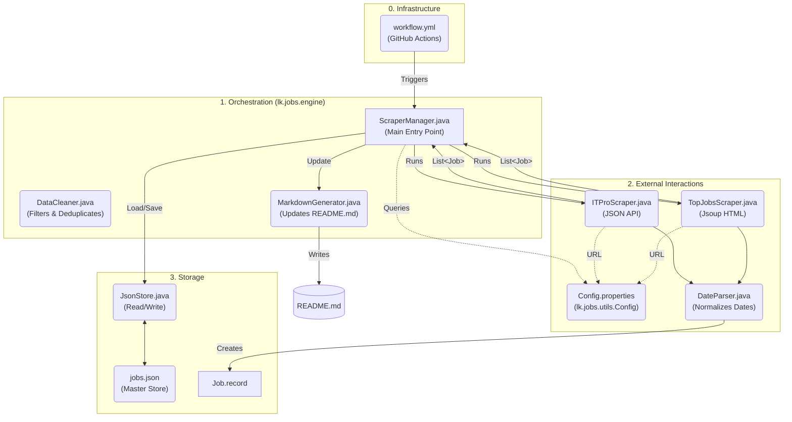

# 🇱🇰 Sri Lanka Software Engineering Jobs | 2026 Tracker [](https://t.me/SL_Software_Jobs)
Looking for software engineering jobs in Sri Lanka? This tracker updates daily with intern, junior, and senior IT roles across Colombo and beyond
Automated Software Engineering Job Tracker for Sri Lanka. Scrapes and categorizes Intern, Associate, and SE roles daily using Java (Jsoup) and GitHub Actions.

> [!TIP]
> **Help keep this project alive!** If this tool helped you find a lead today, please [**Star ⭐ the repo**](https://github.com/Senadeera-NK/sri-lanka-software-jobs). It’s how I measure the impact on our dev community! 🇱🇰

> [!IMPORTANT]
> **Automatic Staleness Purge:** The engine automatically removes listings older than **14 days**, ensuring the feed stays relevant and high-signal.

> **Live Analytics & Daily Software Job Tracker for Sri Lanka**

[📊 View Live Dashboard](https://sri-lanka-software-jobs.vercel.app/)

 
*Click the link above to see real-time trends, seniority distribution, and top hiring companies.*

## 📊 Current Job Openings
> 🟢 **Last Updated:** November 14,12:11 AM (Just now)  | **Total Jobs Found:** 69

### 🎓 Internships & Trainees  (9)

| Title | Company | Level  | Posted | Source |
| :--- | :--- | :--- | :--- | :--- |
| [Intern - Data Protection & Privacy](https://www.topjobs.lk/employer/JobAdvertismentServlet?ac=DEFZZZ&jc=0001570591&ec=DEFZZZ) | ?Mercantile Investments and Finance PLC | Intern | 2&nbsp;days&nbsp;ago | TopJobs.lk |
| [Intern - Software Engineer](https://www.topjobs.lk/employer/JobAdvertismentServlet?ac=DEFZZZ&jc=0001570199&ec=DEFZZZ) | Akhtari Trades (Pvt) Ltd | Intern | 3&nbsp;days&nbsp;ago | TopJobs.lk |
| [Intern Full Stack Engineer (.Net and Angular) - Colombo 3](https://www.topjobs.lk/employer/JobAdvertismentServlet?ac=DEFZZZ&jc=0001569240&ec=DEFZZZ) | MedCubeUSA | Intern | 5&nbsp;days&nbsp;ago | TopJobs.lk |
| [Full Stack Developer - Internship \| Junior Level (Night Shi...](https://www.topjobs.lk/employer/JobAdvertismentServlet?ac=DEFZZZ&jc=0001569235&ec=DEFZZZ) | MedCubeUSA | Intern | 5&nbsp;days&nbsp;ago | TopJobs.lk |
| [Trainee / Intern - Software Developer (Work from Home)](https://www.topjobs.lk/employer/JobAdvertismentServlet?ac=DEFZZZ&jc=0001569012&ec=DEFZZZ) | Hightechx Software Solutions (PVT) Ltd | Intern | 5&nbsp;days&nbsp;ago | TopJobs.lk |
| [Intern - Software Engineering](https://rooster.jobs/jobs/520044) | Zegates International Private Limited | Intern | 12&nbsp;days&nbsp;ago | Rooster.jobs |
| [QA Interns](https://www.topjobs.lk/employer/JobAdvertismentServlet?ac=DEFZZZ&jc=0001566545&ec=DEFZZZ) | Fetchseed (Pvt) Ltd | Intern | 12&nbsp;days&nbsp;ago | TopJobs.lk |
| [Intern - Content Developer](https://www.topjobs.lk/employer/JobAdvertismentServlet?ac=DEFZZZ&jc=0001566107&ec=DEFZZZ) | Zuse Technologies (Pvt) Ltd | Intern | 15&nbsp;days&nbsp;ago | TopJobs.lk |
| [Technical Data Processing Intern](https://www.topjobs.lk/employer/JobAdvertismentServlet?ac=DEFZZZ&jc=0001566022&ec=DEFZZZ) | North Sails Sri Lanka | Intern | 15&nbsp;days&nbsp;ago | TopJobs.lk |

---

### 💻 Associate & Junior/SE Roles  (36)

| Title | Company | Level  | Posted | Source |
| :--- | :--- | :--- | :--- | :--- |
| [Information Security Engineer (1)](https://www.topjobs.lk/employer/JobAdvertismentServlet?ac=0000000271&jc=0001539697&ec=0000000350) | CMS (Pvt) Ltd | Junior/SE | 12&nbsp;hours&nbsp;ago | TopJobs.lk |
| [E-Commerce Executive \| System Implementation Engineer](https://www.topjobs.lk/employer/JobAdvertismentServlet?ac=DEFZZZ&jc=0001570753&ec=DEFZZZ) | Dipro IT | Junior/SE | 12&nbsp;hours&nbsp;ago | TopJobs.lk |
| [Backend Software Engineer](https://www.topjobs.lk/employer/JobAdvertismentServlet?ac=DEFZZZ&jc=0001571048&ec=DEFZZZ) | Hexacorp SL (Private) Limited | Junior/SE | 12&nbsp;hours&nbsp;ago | TopJobs.lk |
| [Platform & Integration Engineer (AUS Calendar - AUS Shift) (1)](https://www.topjobs.lk/employer/JobAdvertismentServlet?ac=0000000064&jc=0001571280&ec=0000000445) | H Connect International (Pvt) Ltd | Junior/SE | 12&nbsp;hours&nbsp;ago | TopJobs.lk |
| [Document and Quality Controller (Contract Basis)](https://www.topjobs.lk/employer/JobAdvertismentServlet?ac=DEFZZZ&jc=0001570976&ec=DEFZZZ) | BOC IT Solutions (Pvt) Ltd | Junior/SE | 12&nbsp;hours&nbsp;ago | TopJobs.lk |
| [Data & Analytics Engineer (AUS Calendar - AUS Shift) (1)](https://www.topjobs.lk/employer/JobAdvertismentServlet?ac=0000000064&jc=0001571296&ec=0000000445) | H Connect International (Pvt) Ltd | Junior/SE | 12&nbsp;hours&nbsp;ago | TopJobs.lk |
| [Automation Engineer (AUS Calendar - AUS Shift) (1)](https://www.topjobs.lk/employer/JobAdvertismentServlet?ac=0000000064&jc=0001571285&ec=0000000445) | H Connect International (Pvt) Ltd | Junior/SE | 12&nbsp;hours&nbsp;ago | TopJobs.lk |
| [Data Engineer](https://www.topjobs.lk/employer/JobAdvertismentServlet?ac=DEFZZZ&jc=0001566171&ec=DEFZZZ) | ORYSYS Limited | Junior/SE | Yesterday | TopJobs.lk |
| [DevOps & Infrastructure Specialist - Colombo 3](https://www.topjobs.lk/employer/JobAdvertismentServlet?ac=DEFZZZ&jc=0001570652&ec=DEFZZZ) | XPAND | Junior/SE | 2&nbsp;days&nbsp;ago | TopJobs.lk |
| [Data Analyst](https://www.topjobs.lk/employer/JobAdvertismentServlet?ac=DEFZZZ&jc=0001570564&ec=DEFZZZ) | Hettigoda Industries (Siddhalepa) | Junior/SE | 2&nbsp;days&nbsp;ago | TopJobs.lk |
| [Associate Engineer - Agentic AI (1)](https://www.topjobs.lk/employer/JobAdvertismentServlet?ac=0000000201&jc=0001569685&ec=0000000241) | D.Samson & Sons Ltd | Associate | 4&nbsp;days&nbsp;ago | TopJobs.lk |
| [IT Executive / Zoho Developer (1)](https://www.topjobs.lk/employer/JobAdvertismentServlet?ac=0000000390&jc=0001569564&ec=0000000513) | KDG GLOBAL | Junior/SE | 4&nbsp;days&nbsp;ago | TopJobs.lk |
| [Software Engineer JAVA (1)](https://www.topjobs.lk/employer/JobAdvertismentServlet?ac=0000000492&jc=0001569511&ec=0000000661) | DirectFN | Junior/SE | 4&nbsp;days&nbsp;ago | TopJobs.lk |
| [Junior Software Trainee](https://www.topjobs.lk/employer/JobAdvertismentServlet?ac=DEFZZZ&jc=0001569485&ec=DEFZZZ) | Webappclouds (Pvt) Ltd | Associate | 4&nbsp;days&nbsp;ago | TopJobs.lk |
| [IT Helpdesk Engineer - Male (20)](https://www.topjobs.lk/employer/JobAdvertismentServlet?ac=0000000419&jc=0001569219&ec=0000000552) | Micronet Global Services (Pvt) Ltd | Junior/SE | 5&nbsp;days&nbsp;ago | TopJobs.lk |
| [Database Administrator - DBA](https://www.topjobs.lk/employer/JobAdvertismentServlet?ac=DEFZZZ&jc=0001569076&ec=DEFZZZ) | Onsys Technologies | Junior/SE | 5&nbsp;days&nbsp;ago | TopJobs.lk |
| [Security and Compliance Specialist](https://rooster.jobs/jobs/520086) | Nextjob | Junior/SE | 5&nbsp;days&nbsp;ago | Rooster.jobs |
| [Security and Compliance Specialist (Part-time & Hybrid)](https://rooster.jobs/jobs/520086) | Nextjob | Junior/SE | 5&nbsp;days&nbsp;ago | Rooster.jobs |
| [Trainee Software Engineer](https://www.topjobs.lk/employer/JobAdvertismentServlet?ac=DEFZZZ&jc=0001568384&ec=DEFZZZ) | Hedanship Asia (Pvt) Ltd | Associate | 8&nbsp;days&nbsp;ago | TopJobs.lk |
| [Data Engineer (1)](https://www.topjobs.lk/employer/JobAdvertismentServlet?ac=0000000376&jc=0001568602&ec=0000000493) | Assetline Finance PLC | Junior/SE | 8&nbsp;days&nbsp;ago | TopJobs.lk |
| [Business Analyst cum Software Quality Assurance Engineer](https://www.topjobs.lk/employer/JobAdvertismentServlet?ac=DEFZZZ&jc=0001568083&ec=DEFZZZ) | "Company Name With held" | Junior/SE | 9&nbsp;days&nbsp;ago | TopJobs.lk |
| [QA Engineer](https://www.topjobs.lk/employer/JobAdvertismentServlet?ac=DEFZZZ&jc=0001567982&ec=DEFZZZ) | Koombiyo Delivery (Pvt) Ltd | Junior/SE | 9&nbsp;days&nbsp;ago | TopJobs.lk |
| [AI Engineer (Application Development Focus)](https://www.topjobs.lk/employer/JobAdvertismentServlet?ac=DEFZZZ&jc=0001567934&ec=DEFZZZ) | Asiawise Lanka (Pvt) Ltd | Junior/SE | 9&nbsp;days&nbsp;ago | TopJobs.lk |
| [Java Software Engineer](https://www.topjobs.lk/employer/JobAdvertismentServlet?ac=DEFZZZ&jc=0001567746&ec=DEFZZZ) | LAUGFS Eco Sri Ltd | Junior/SE | 10&nbsp;days&nbsp;ago | TopJobs.lk |
| [Executive - BI & AI Engineer](https://www.topjobs.lk/employer/JobAdvertismentServlet?ac=DEFZZZ&jc=0001567720&ec=DEFZZZ) | Dart Global Logistics | Junior/SE | 10&nbsp;days&nbsp;ago | TopJobs.lk |
| [Web Developer](https://www.topjobs.lk/employer/JobAdvertismentServlet?ac=DEFZZZ&jc=0001567638&ec=DEFZZZ) | Damro | Junior/SE | 10&nbsp;days&nbsp;ago | TopJobs.lk |
| [Software Engineer](https://www.topjobs.lk/employer/JobAdvertismentServlet?ac=DEFZZZ&jc=0001567410&ec=DEFZZZ) | Sri Lanka Insurance General | Junior/SE | 10&nbsp;days&nbsp;ago | TopJobs.lk |
| [Experienced React Native Mobile App Developer](https://www.topjobs.lk/employer/JobAdvertismentServlet?ac=DEFZZZ&jc=0001561563&ec=DEFZZZ) | Nascent Grow (Pvt) Ltd | Junior/SE | 11&nbsp;days&nbsp;ago | TopJobs.lk |
| [Software Engineer - Frontend](https://www.topjobs.lk/employer/JobAdvertismentServlet?ac=DEFZZZ&jc=0001567242&ec=DEFZZZ) | InSync Information Technologies Pvt Ltd | Junior/SE | 11&nbsp;days&nbsp;ago | TopJobs.lk |
| [Full Stack Developer (Java & React)](https://www.topjobs.lk/employer/JobAdvertismentServlet?ac=DEFZZZ&jc=0001567162&ec=DEFZZZ) | Fortunaglobal (Pvt) Limited | Junior/SE | 11&nbsp;days&nbsp;ago | TopJobs.lk |
| [Cloud Engineer - UAE (1)](https://www.topjobs.lk/employer/JobAdvertismentServlet?ac=0000000049&jc=0001566708&ec=0000000313) | John Keells IT | Junior/SE | 12&nbsp;days&nbsp;ago | TopJobs.lk |
| [Full Stack Mobile App Developer (Flutter + Node.js)](https://www.topjobs.lk/employer/JobAdvertismentServlet?ac=DEFZZZ&jc=0001566670&ec=DEFZZZ) | Ceylon Institute of Software Enginnering and Law | Junior/SE | 12&nbsp;days&nbsp;ago | TopJobs.lk |
| [Associate Data Analyst - Data Compliance](https://www.topjobs.lk/employer/JobAdvertismentServlet?ac=DEFZZZ&jc=0001561356&ec=DEFZZZ) | Affixcon Pty Ltd | Associate | 13&nbsp;days&nbsp;ago | TopJobs.lk |
| [AI Developer](https://www.topjobs.lk/employer/JobAdvertismentServlet?ac=DEFZZZ&jc=0001566183&ec=DEFZZZ) | CSG Technologies | Junior/SE | 15&nbsp;days&nbsp;ago | TopJobs.lk |
| [Executive - Business Data Analyst (Male) - Boralesgamuwa](https://www.topjobs.lk/employer/JobAdvertismentServlet?ac=DEFZZZ&jc=0001565702&ec=DEFZZZ) | Company Name Withheld | Junior/SE | 15&nbsp;days&nbsp;ago | TopJobs.lk |
| [Security Architect (1)](https://www.topjobs.lk/employer/JobAdvertismentServlet?ac=0000000419&jc=0001565797&ec=0000000552) | Micronet Global Services (Pvt) Ltd | Junior/SE | 15&nbsp;days&nbsp;ago | TopJobs.lk |

---

### 🚀 Senior & Lead Roles  (24)

| Title | Company | Level  | Posted | Source |
| :--- | :--- | :--- | :--- | :--- |
| [Senior Application Security Engineer (1)](https://www.topjobs.lk/employer/JobAdvertismentServlet?ac=0000000271&jc=0001562903&ec=0000000350) | CMS (Pvt) Ltd | Senior | 12&nbsp;hours&nbsp;ago | TopJobs.lk |
| [Senior Full Stack Software Engineer](https://www.topjobs.lk/employer/JobAdvertismentServlet?ac=DEFZZZ&jc=0001571133&ec=DEFZZZ) | XPAND | Senior | 12&nbsp;hours&nbsp;ago | TopJobs.lk |
| [Teach Lead - Machine Learning (ML)](https://www.topjobs.lk/employer/JobAdvertismentServlet?ac=DEFZZZ&jc=0001566151&ec=DEFZZZ) | ORYSYS Limited | Senior | Yesterday | TopJobs.lk |
| [Tech Lead - AI](https://www.topjobs.lk/employer/JobAdvertismentServlet?ac=DEFZZZ&jc=0001566135&ec=DEFZZZ) | ORYSYS Limited | Senior | Yesterday | TopJobs.lk |
| [Tech Lead - AI Solutions](https://www.topjobs.lk/employer/JobAdvertismentServlet?ac=DEFZZZ&jc=0001566076&ec=DEFZZZ) | ORYSYS Limited | Senior | Yesterday | TopJobs.lk |
| [Senior Data Engineer](https://www.topjobs.lk/employer/JobAdvertismentServlet?ac=DEFZZZ&jc=0001566165&ec=DEFZZZ) | ORYSYS Limited | Senior | Yesterday | TopJobs.lk |
| [Engineer \| Senior Engineer - Data Engineering](https://www.topjobs.lk/employer/JobAdvertismentServlet?ac=0000000494&jc=0001570562&ec=0000000666) | Acentura Pvt Ltd | Senior | 2&nbsp;days&nbsp;ago | TopJobs.lk |
| [Tech Lead - Senior Backend Developer (Python)](https://www.topjobs.lk/employer/JobAdvertismentServlet?ac=DEFZZZ&jc=0001570397&ec=DEFZZZ) | Seren IT Services | Senior | 2&nbsp;days&nbsp;ago | TopJobs.lk |
| [Senior Software Engineer - . NET (1)](https://www.topjobs.lk/employer/JobAdvertismentServlet?ac=0000000375&jc=0001570367&ec=0000000492) | Jobfactory | Senior | 3&nbsp;days&nbsp;ago | TopJobs.lk |
| [Backend Technical Lead (Node/TypeScript) - REF8600](https://rooster.jobs/jobs/520096) | Creative Software | Senior | 3&nbsp;days&nbsp;ago | Rooster.jobs |
| [Senior Full-Stack Software Engineer](https://www.topjobs.lk/employer/JobAdvertismentServlet?ac=DEFZZZ&jc=0001569561&ec=DEFZZZ) | Avagance Limited | Senior | 4&nbsp;days&nbsp;ago | TopJobs.lk |
| [Senior EDI Engineer (1)](https://www.topjobs.lk/employer/JobAdvertismentServlet?ac=0000000280&jc=0001569016&ec=0000000510) | Expolanka Freight (Pvt) Ltd | Senior | 5&nbsp;days&nbsp;ago | TopJobs.lk |
| [Senior Quality Assurance Engineer (1)](https://www.topjobs.lk/employer/JobAdvertismentServlet?ac=0000000280&jc=0001569017&ec=0000000510) | Expolanka Freight (Pvt) Ltd | Senior | 5&nbsp;days&nbsp;ago | TopJobs.lk |
| [Senior Software Engineer](https://www.topjobs.lk/employer/JobAdvertismentServlet?ac=DEFZZZ&jc=0001568547&ec=DEFZZZ) | Company Name Withheld | Senior | 8&nbsp;days&nbsp;ago | TopJobs.lk |
| [Senior DevOps Engineer](https://www.topjobs.lk/employer/JobAdvertismentServlet?ac=DEFZZZ&jc=0001568397&ec=DEFZZZ) | Mobitel (Pvt) Ltd | Senior | 8&nbsp;days&nbsp;ago | TopJobs.lk |
| [Software Engineer / Senior Software Engineer (1)](https://www.topjobs.lk/employer/JobAdvertismentServlet?ac=0000000141&jc=0001568783&ec=0000000159) | Informatics Group of Companies | Senior | 8&nbsp;days&nbsp;ago | TopJobs.lk |
| [Senior UI \| UX Engineer (Full Time \| On Site)](https://www.topjobs.lk/employer/JobAdvertismentServlet?ac=DEFZZZ&jc=0001563256&ec=DEFZZZ) | Treinetic (Pvt) Ltd | Senior | 8&nbsp;days&nbsp;ago | TopJobs.lk |
| [Senior Java Software Engineer](https://www.topjobs.lk/employer/JobAdvertismentServlet?ac=DEFZZZ&jc=0001567737&ec=DEFZZZ) | LAUGFS Eco Sri Ltd | Senior | 10&nbsp;days&nbsp;ago | TopJobs.lk |
| [Senior Executive - AI Integration Engineer](https://www.topjobs.lk/employer/JobAdvertismentServlet?ac=DEFZZZ&jc=0001567715&ec=DEFZZZ) | Dart Global Logistics | Senior | 10&nbsp;days&nbsp;ago | TopJobs.lk |
| [Senior Software Engineer - Fullstack (Java)](https://www.topjobs.lk/employer/JobAdvertismentServlet?ac=DEFZZZ&jc=0001567189&ec=DEFZZZ) | HRC Labs | Senior | 11&nbsp;days&nbsp;ago | TopJobs.lk |
| [Senior Quality Assurance Engineer - Automation](https://www.topjobs.lk/employer/JobAdvertismentServlet?ac=DEFZZZ&jc=0001567182&ec=DEFZZZ) | HRC Labs | Senior | 11&nbsp;days&nbsp;ago | TopJobs.lk |
| [Senior Software Engineer JAVA (4)](https://www.topjobs.lk/employer/JobAdvertismentServlet?ac=0000000492&jc=0001566910&ec=0000000661) | DirectFN | Senior | 11&nbsp;days&nbsp;ago | TopJobs.lk |
| [Senior Software Engineer HTML5 (1)](https://www.topjobs.lk/employer/JobAdvertismentServlet?ac=0000000492&jc=0001566909&ec=0000000661) | DirectFN | Senior | 11&nbsp;days&nbsp;ago | TopJobs.lk |
| [Senior Software Engineers \| Software Engineers](https://www.topjobs.lk/employer/JobAdvertismentServlet?ac=DEFZZZ&jc=0001566265&ec=DEFZZZ) | Elegant Media (Pvt) Ltd | Senior | 15&nbsp;days&nbsp;ago | TopJobs.lk |

---


## 🛠️ How it Works
1. **Engine:** A Java 21 console application using **Jsoup**.
2. **Sources:** Currently scraping `ITPro.lk` and  `TopJobs`. Support for and `Rooster.jobs` is under development (Contributors welcome!)
3. **Automation:** Runs every 12 hours via **GitHub Actions**.
4. **Storage:** Updates this `README.md` and a `jobs.json` file automatically.

<details>
<summary><b>📐 View High-Level Architecture Diagram</b></summary>
    


</details>

<details>
<summary><b>📂 View Project Structure</b></summary>

```text
src/main/java/lk/jobs/
├── engine/           # Logic for sorting, cleaning, and README updates
├── model/            # Data models (Job Record)
├── scrapers/         # Individual site scrapers
└── utils/            # JSON and Date parsing utilities
```
</details>

## 🚀 Usage
If you want to run the scraper locally:
1. Clone the repo.
2. Ensure you have **JDK 21** and **Maven** installed.
3. Run: mvn clean compile exec:java -Dexec.mainClass="lk.jobs.engine.ScraperManager"

## 🤝 Contributing
Contributions are what make the open-source community such an amazing place to learn, inspire, and create.
Any contributions you make are **greatly appreciated**.

* **Found a bug?** Open an [Issue](https://github.com/Senadeera-NK/sl-software-engineering-jobs/issues).
* **Want to add a new site?** Check out our [Contributing Guidelines](CONTRIBUTING.md) to see how to implement a new scraper.
* **Missing a job?** Feel free to submit a Pull Request to manually update the table!
