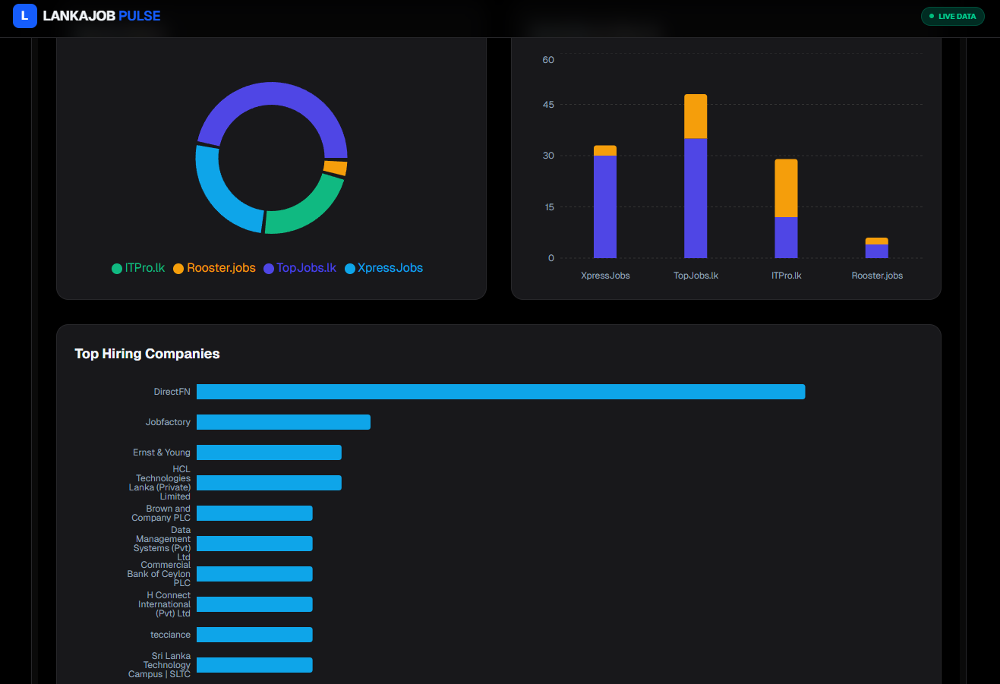
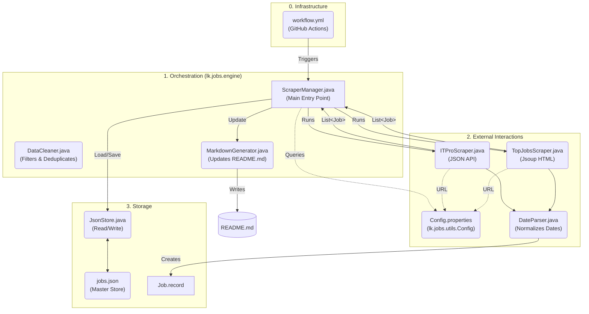

# 🇱🇰 Sri Lanka Software Engineering Jobs | 2026 Tracker [](https://t.me/SL_Software_Jobs)
Looking for software engineering jobs in Sri Lanka? This tracker updates daily with intern, junior, and senior IT roles across Colombo and beyond
Automated Software Engineering Job Tracker for Sri Lanka. Scrapes and categorizes Intern, Associate, and SE roles daily using Java (Jsoup) and GitHub Actions.

> [!TIP]
> **Help keep this project alive!** If this tool helped you find a lead today, please [**Star ⭐ the repo**](https://github.com/Senadeera-NK/sri-lanka-software-jobs). It’s how I measure the impact on our dev community! 🇱🇰

> [!IMPORTANT]
> **Automatic Staleness Purge:** The engine automatically removes listings older than **14 days**, ensuring the feed stays relevant and high-signal.

> **Live Analytics & Daily Software Job Tracker for Sri Lanka**

[📊 View Live Dashboard](https://sri-lanka-software-jobs.vercel.app/)

 
*Click the link above to see real-time trends, seniority distribution, and top hiring companies.*

## 📊 Current Job Openings
> 🟢 **Last Updated:** October 24,3:15 PM (Just now)  | **Total Jobs Found:** 137

### 🎓 Internships & Trainees  (41)

| Title | Company | Level  | Posted | Source |
| :--- | :--- | :--- | :--- | :--- |
| [QA Intern](https://itpro.lk/job/15558/qa-intern-at-adeona-technologies/) | Adeona Technologies | Intern | 23&nbsp;hours&nbsp;ago | ITPro.lk |
| [QA Engineer Intern (iOS & Web)](https://itpro.lk/job/15557/qa-engineer-intern-ios-web-at-messagefuture-inc/) | MessageFuture Inc. | Intern | Yesterday | ITPro.lk |
| [QA Engineer Intern (Windows & Android)](https://itpro.lk/job/15556/qa-engineer-intern-windows-android-at-messagefuture-inc/) | MessageFuture Inc. | Intern | Yesterday | ITPro.lk |
| [ERP and Data - Intern](https://www.topjobs.lk/employer/JobAdvertismentServlet?ac=DEFZZZ&jc=0001563413&ec=DEFZZZ) | IPD Colombo (Pvt) Ltd | Intern | Yesterday | TopJobs.lk |
| [Software Engineering Intern](https://itpro.lk/job/15552/software-engineering-intern-at-nextgen-codex-pvt-ltd/) | NextGen CodeX (Pvt) Ltd | Intern | Yesterday | ITPro.lk |
| [Intern Software Engineer](https://itpro.lk/job/15546/intern-software-engineer-at-join-solutionex-technologies-pvt-ltd/) | Join Solutionex Technologies (PVT) LTD | Intern | Yesterday | ITPro.lk |
| [Full Stack Developer (Trainee Internship)](https://itpro.lk/job/15541/full-stack-developer-trainee-internship-at-itx-digital-services-pvt-ltd/) | ITX Digital Services (Pvt) Ltd | Intern | Yesterday | ITPro.lk |
| [Software Engineer Intern](https://itpro.lk/job/15538/software-engineer-intern-at-sans-technologies/) | Sans Technologies | Intern | 2&nbsp;days&nbsp;ago | ITPro.lk |
| [Intern - Odoo Developer](https://itpro.lk/job/15528/intern-odoo-developer-at-everestx-technologies/) | EverestX Technologies | Intern | 3&nbsp;days&nbsp;ago | ITPro.lk |
| [QA Intern (1)](https://www.topjobs.lk/employer/JobAdvertismentServlet?ac=0000000375&jc=0001562026&ec=0000000492) | Jobfactory | Intern | 3&nbsp;days&nbsp;ago | TopJobs.lk |
| [Software Engineer Intern](https://itpro.lk/job/14475/software-engineer-intern-at-alphintra/) | Alphintra | Intern | 4&nbsp;days&nbsp;ago | ITPro.lk |
| [Full Stack Developement Intern](https://itpro.lk/job/15518/full-stack-developement-intern-at-futura-solutions/) | Futura Solutions | Intern | 4&nbsp;days&nbsp;ago | ITPro.lk |
| [Intern Software Engineer](https://itpro.lk/job/15515/intern-software-engineer-at-bitslize-concepts/) | BitSlize Concepts | Intern | 5&nbsp;days&nbsp;ago | ITPro.lk |
| [Software Engineer Internship](https://itpro.lk/job/15513/software-engineer-internship-at-zenzebz-technologies/) | Zenzebz Technologies | Intern | 5&nbsp;days&nbsp;ago | ITPro.lk |
| [Intern Software Engineer (PHP Laravel)](https://itpro.lk/job/15509/intern-software-engineer-php-laravel-at-inbizsys-private-limited/) | InBizSys (Private) Limited | Intern | 5&nbsp;days&nbsp;ago | ITPro.lk |
| [Intern - Technical Data Processing](https://www.topjobs.lk/employer/JobAdvertismentServlet?ac=DEFZZZ&jc=0001561401&ec=DEFZZZ) | North Sails | Intern | 5&nbsp;days&nbsp;ago | TopJobs.lk |
| [Backend Engineer Intern](https://itpro.lk/job/15452/backend-engineer-intern-at-delivergate/) | Delivergate | Intern | 6&nbsp;days&nbsp;ago | ITPro.lk |
| [Developer Intern](https://itpro.lk/job/15498/developer-intern-at-focaldive/) | FocalDive | Intern | 7&nbsp;days&nbsp;ago | ITPro.lk |
| [QA Intern](https://itpro.lk/job/15497/qa-intern-at-focaldive/) | FocalDive | Intern | 7&nbsp;days&nbsp;ago | ITPro.lk |
| [Intern Software Engineer (PHP Laravel)](https://itpro.lk/job/15492/intern-software-engineer-php-laravel-at-quantix/) | Quantix | Intern | 7&nbsp;days&nbsp;ago | ITPro.lk |
| [Intern Software Engineer](https://itpro.lk/job/15140/intern-software-engineer-at-codimite/) | Codimite | Intern | 8&nbsp;days&nbsp;ago | ITPro.lk |
| [Software Engineer Internship (Mobile Application)](https://itpro.lk/job/15484/software-engineer-internship-mobile-application-at-explore-vacations-travels-pvt-ltd/) | Explore Vacations & Travels (Pvt) Ltd | Intern | 8&nbsp;days&nbsp;ago | ITPro.lk |
| [Internship Back-End Developer - PHP / JAVA](https://itpro.lk/job/14313/internship-backend-developer-php-java-at-neo-solution/) | Neo Solution | Intern | 8&nbsp;days&nbsp;ago | ITPro.lk |
| [Intern & Associate - Software Engineer](https://www.topjobs.lk/employer/JobAdvertismentServlet?ac=DEFZZZ&jc=0001560708&ec=DEFZZZ) | Muve Mobility (Pvt) Ltd | Intern | 8&nbsp;days&nbsp;ago | TopJobs.lk |
| [Full Stack Developer Intern](https://www.topjobs.lk/employer/JobAdvertismentServlet?ac=DEFZZZ&jc=0001560546&ec=DEFZZZ) | MedCubeUSA | Intern | 8&nbsp;days&nbsp;ago | TopJobs.lk |
| [Full Stack Software Engineer Intern – React & TypeScript](https://itpro.lk/job/15482/full-stack-software-engineer-intern-react-typescript-at-netwitx/) | Netwitx | Intern | 8&nbsp;days&nbsp;ago | ITPro.lk |
| [QA Internship](https://itpro.lk/job/15479/qa-internship-at-era-biz-solutions/) | Era Biz Solutions | Intern | 8&nbsp;days&nbsp;ago | ITPro.lk |
| [Full Stack Developer Intern](https://itpro.lk/job/15478/full-stack-developer-intern-at-mydynamica/) | MyDynamica | Intern | 8&nbsp;days&nbsp;ago | ITPro.lk |
| [Engineering Intern](https://itpro.lk/job/15364/engineering-intern-at-verdentra/) | Verdentra | Intern | 9&nbsp;days&nbsp;ago | ITPro.lk |
| [Full-Stack Software Engineering Intern](https://itpro.lk/job/15473/fullstack-software-engineering-intern-at-coffee-ninja-pvt-ltd/) | Coffee Ninja (Pvt) Ltd | Intern | 9&nbsp;days&nbsp;ago | ITPro.lk |
| [Technical Data Processing Intern (Front End Operations)](https://www.topjobs.lk/employer/JobAdvertismentServlet?ac=DEFZZZ&jc=0001560192&ec=DEFZZZ) | North Sails | Intern | 9&nbsp;days&nbsp;ago | TopJobs.lk |
| [Software Engineering Intern – Full-Stack Development](https://itpro.lk/job/14857/software-engineering-intern-fullstack-development-at-urban-innovation-services/) | Urban Innovation Services | Intern | 10&nbsp;days&nbsp;ago | ITPro.lk |
| [QA Intern (Software Quality Assurance)](https://itpro.lk/job/15462/qa-intern-software-quality-assurance-at-cyphlab-pvt-ltd/) | CyphLab (PVT) LTD | Intern | 10&nbsp;days&nbsp;ago | ITPro.lk |
| [Intern - Quality Assurance](https://itpro.lk/job/15459/intern-quality-assurance-at-xeynergy/) | Xeynergy | Intern | 10&nbsp;days&nbsp;ago | ITPro.lk |
| [Fullstack Internship](https://itpro.lk/job/14116/fullstack-internship-at-univiser/) | UNIVISER | Intern | 10&nbsp;days&nbsp;ago | ITPro.lk |
| [Intern Software Engineer](https://itpro.lk/job/15447/intern-software-engineer-at-knovik/) | Knovik | Intern | 11&nbsp;days&nbsp;ago | ITPro.lk |
| [Python Developer Intern](https://itpro.lk/job/14537/python-developer-intern-at-looplab-pvt-ltd/) | LoopLab (Pvt) Ltd | Intern | 12&nbsp;days&nbsp;ago | ITPro.lk |
| [MERN Stack Developer Intern](https://itpro.lk/job/14538/mern-stack-developer-intern-at-looplab-pvt-ltd/) | LoopLab (Pvt) Ltd | Intern | 12&nbsp;days&nbsp;ago | ITPro.lk |
| [Software Engineering Intern](https://itpro.lk/job/15435/software-engineering-intern-at-jrc-software/) | JRC Software | Intern | 12&nbsp;days&nbsp;ago | ITPro.lk |
| [Full Stack Developer Intern (AI Product Development)](https://itpro.lk/job/15434/full-stack-developer-intern-ai-product-development-at-ranga-technologies/) | Ranga Technologies | Intern | 12&nbsp;days&nbsp;ago | ITPro.lk |
| [QA Engineer Intern](https://itpro.lk/job/15431/qa-engineer-intern-at-codeverse-labs/) | Codeverse Labs | Intern | 14&nbsp;days&nbsp;ago | ITPro.lk |

---

### 💻 Associate & Junior/SE Roles  (58)

| Title | Company | Level  | Posted | Source |
| :--- | :--- | :--- | :--- | :--- |
| [Full Stack Web Developer](https://www.topjobs.lk/employer/JobAdvertismentServlet?ac=DEFZZZ&jc=0001560042&ec=DEFZZZ) | XERO Lanka Pvt Ltd | Junior/SE | 15&nbsp;hours&nbsp;ago | TopJobs.lk |
| [Experienced React Native Mobile App Developer](https://www.topjobs.lk/employer/JobAdvertismentServlet?ac=DEFZZZ&jc=0001561563&ec=DEFZZZ) | Nascent Grow (Pvt) Ltd | Junior/SE | 15&nbsp;hours&nbsp;ago | TopJobs.lk |
| [Associate Data Analyst - Data Compliance](https://www.topjobs.lk/employer/JobAdvertismentServlet?ac=DEFZZZ&jc=0001561356&ec=DEFZZZ) | Affixcon Pty Ltd | Associate | 15&nbsp;hours&nbsp;ago | TopJobs.lk |
| [Software Engineer (Python)](https://itpro.lk/job/15560/software-engineer-python-at-innodata-lanka/) | Innodata Lanka | Junior/SE | 22&nbsp;hours&nbsp;ago | ITPro.lk |
| [SQL Database Administrator (1)](https://www.topjobs.lk/employer/JobAdvertismentServlet?ac=0000000271&jc=0001533299&ec=0000000350) | CMS (Pvt) Ltd | Junior/SE | Yesterday | TopJobs.lk |
| [Data Platform Engineer (1)](https://www.topjobs.lk/employer/JobAdvertismentServlet?ac=0000000271&jc=0001533297&ec=0000000350) | CMS (Pvt) Ltd | Junior/SE | Yesterday | TopJobs.lk |
| [Information Security Analyst (1)](https://www.topjobs.lk/employer/JobAdvertismentServlet?ac=0000000271&jc=0001532706&ec=0000000350) | CMS (Pvt) Ltd | Junior/SE | Yesterday | TopJobs.lk |
| [Information Security Engineer (1)](https://www.topjobs.lk/employer/JobAdvertismentServlet?ac=0000000271&jc=0001539697&ec=0000000350) | CMS (Pvt) Ltd | Junior/SE | Yesterday | TopJobs.lk |
| [Trainee Developers - Odoo](https://www.topjobs.lk/employer/JobAdvertismentServlet?ac=DEFZZZ&jc=0001563019&ec=DEFZZZ) | Softserve (Private) Limited | Associate | Yesterday | TopJobs.lk |
| [Data & Analytics Engineer (AUS Calendar - AUS Shift) (1)](https://www.topjobs.lk/employer/JobAdvertismentServlet?ac=0000000064&jc=0001563582&ec=0000000445) | H Connect International (Pvt) Ltd | Junior/SE | Yesterday | TopJobs.lk |
| [Platform & Integration Engineer (AUS Calendar - AUS Shift) (1)](https://www.topjobs.lk/employer/JobAdvertismentServlet?ac=0000000064&jc=0001563599&ec=0000000445) | H Connect International (Pvt) Ltd | Junior/SE | Yesterday | TopJobs.lk |
| [Automation Engineer (AUS Calendar - AUS Shift) (1)](https://www.topjobs.lk/employer/JobAdvertismentServlet?ac=0000000064&jc=0001563580&ec=0000000445) | H Connect International (Pvt) Ltd | Junior/SE | Yesterday | TopJobs.lk |
| [Data Engineer - Python](https://www.topjobs.lk/employer/JobAdvertismentServlet?ac=DEFZZZ&jc=0001563250&ec=DEFZZZ) | Asiawise Lanka (Pvt) Ltd | Junior/SE | Yesterday | TopJobs.lk |
| [Application Developer (Night Shift)](https://www.topjobs.lk/employer/JobAdvertismentServlet?ac=DEFZZZ&jc=0001563182&ec=DEFZZZ) | Legacy Health (Pvt) Ltd | Junior/SE | Yesterday | TopJobs.lk |
| [GEO - Technical Engineer / Technologist](https://www.topjobs.lk/employer/JobAdvertismentServlet?ac=DEFZZZ&jc=0001563102&ec=DEFZZZ) | ELS Group of Companieis | Junior/SE | Yesterday | TopJobs.lk |
| [Software Engineer](https://itpro.lk/job/15548/software-engineer-at-mira/) | Mira | Junior/SE | Yesterday | ITPro.lk |
| [Business Operations Executive (IT & Software Company)](https://rooster.jobs/jobs/519965) | Nextjob | Junior/SE | Yesterday | Rooster.jobs |
| [Backend Developer](https://www.topjobs.lk/employer/JobAdvertismentServlet?ac=DEFZZZ&jc=0001562628&ec=DEFZZZ) | True Foam (Pvt) Ltd | Junior/SE | 2&nbsp;days&nbsp;ago | TopJobs.lk |
| [Power Platform Developer (1)](https://www.topjobs.lk/employer/JobAdvertismentServlet?ac=0000000343&jc=0001562319&ec=0000000458) | KPMG Executive Search Private Limited | Junior/SE | 3&nbsp;days&nbsp;ago | TopJobs.lk |
| [Freelance - AI Specialist (50)](https://www.topjobs.lk/employer/JobAdvertismentServlet?ac=0000000148&jc=0001550679&ec=0000000180) | INNODATA LANKA (PVT) LTD | Junior/SE | 3&nbsp;days&nbsp;ago | TopJobs.lk |
| [Progress OpenEdge Developer - Contract](https://itpro.lk/job/15526/progress-openedge-developer-contract-at-zdata-innovations/) | ZData Innovations | Junior/SE | 3&nbsp;days&nbsp;ago | ITPro.lk |
| [Associate Software Engineer (React / React Native) - LAY0100](https://rooster.jobs/jobs/519938) | Creative Software | Associate | 3&nbsp;days&nbsp;ago | Rooster.jobs |
| [SEO Specialist - Experienced in AI (UAE Based)](https://www.topjobs.lk/employer/JobAdvertismentServlet?ac=DEFZZZ&jc=0001561683&ec=DEFZZZ) | Farhat Office & Co. LLC | Junior/SE | 4&nbsp;days&nbsp;ago | TopJobs.lk |
| [AI Content Creator](https://www.topjobs.lk/employer/JobAdvertismentServlet?ac=DEFZZZ&jc=0001561786&ec=DEFZZZ) | Kiddies and Toys International (Pvt) Ltd | Junior/SE | 4&nbsp;days&nbsp;ago | TopJobs.lk |
| [Associate Software Engineer](https://itpro.lk/job/15512/associate-software-engineer-at-zenzebz-technologies/) | Zenzebz Technologies | Associate | 5&nbsp;days&nbsp;ago | ITPro.lk |
| [Database Administrator (DBA)](https://www.topjobs.lk/employer/JobAdvertismentServlet?ac=DEFZZZ&jc=0001558655&ec=DEFZZZ) | Onsys International (Private) Limited | Junior/SE | 5&nbsp;days&nbsp;ago | TopJobs.lk |
| [GRC Analyst - Governance \| Risk and Compliance Analyst (Inf...](https://www.topjobs.lk/employer/JobAdvertismentServlet?ac=DEFZZZ&jc=0001561295&ec=DEFZZZ) | Cargills Bank PLC | Junior/SE | 5&nbsp;days&nbsp;ago | TopJobs.lk |
| [Software Engineer HTML5 (1)](https://www.topjobs.lk/employer/JobAdvertismentServlet?ac=0000000492&jc=0001561151&ec=0000000661) | DirectFN | Junior/SE | 5&nbsp;days&nbsp;ago | TopJobs.lk |
| [Java Spring Boot Software Developer](https://www.topjobs.lk/employer/JobAdvertismentServlet?ac=DEFZZZ&jc=0001561054&ec=DEFZZZ) | Kangaro Tech | Junior/SE | 5&nbsp;days&nbsp;ago | TopJobs.lk |
| [Full Stack Software Developer ](https://rooster.jobs/jobs/519928) | Ceylon Business Appliances (Pvt) Ltd | Junior/SE | 5&nbsp;days&nbsp;ago | Rooster.jobs |
| [Software Developer (Next.js + Laravel + AI)](https://itpro.lk/job/12028/software-developer-nextjs-laravel-ai-at-git-lanka/) | GIT Lanka | Junior/SE | 5&nbsp;days&nbsp;ago | ITPro.lk |
| [Junior Software Developer](https://itpro.lk/job/15501/junior-software-developer-at-vision-designing/) | Vision Designing | Junior/SE | 5&nbsp;days&nbsp;ago | ITPro.lk |
| [Junior Front-End Developer](https://itpro.lk/job/15494/junior-frontend-developer-at-quantix/) | Quantix | Junior/SE | 7&nbsp;days&nbsp;ago | ITPro.lk |
| [Associate - DevOps Engineer](https://www.topjobs.lk/employer/JobAdvertismentServlet?ac=DEFZZZ&jc=0001560920&ec=DEFZZZ) | Legacy Health (Pvt) Ltd | Associate | 8&nbsp;days&nbsp;ago | TopJobs.lk |
| [Full-Stack Engineer](https://www.topjobs.lk/employer/JobAdvertismentServlet?ac=DEFZZZ&jc=0001560867&ec=DEFZZZ) | Levein | Junior/SE | 8&nbsp;days&nbsp;ago | TopJobs.lk |
| [Software Engineer - Python](https://www.topjobs.lk/employer/JobAdvertismentServlet?ac=DEFZZZ&jc=0001560653&ec=DEFZZZ) | InSync Technologies (Pvt) Ltd | Junior/SE | 8&nbsp;days&nbsp;ago | TopJobs.lk |
| [Trainee Mobile Developer - React Native & AI (EdTech)](https://www.topjobs.lk/employer/JobAdvertismentServlet?ac=DEFZZZ&jc=0001561012&ec=DEFZZZ) | Company Name Withheld | Associate | 8&nbsp;days&nbsp;ago | TopJobs.lk |
| [Engineer - MLOps](https://www.topjobs.lk/employer/JobAdvertismentServlet?ac=DEFZZZ&jc=0001555243&ec=DEFZZZ) | ORYSYS Limited | Junior/SE | 9&nbsp;days&nbsp;ago | TopJobs.lk |
| [Associate Business Analyst & Quality Assurance](https://www.topjobs.lk/employer/JobAdvertismentServlet?ac=DEFZZZ&jc=0001559916&ec=DEFZZZ) | Legacy Health (Pvt) Ltd | Associate | 9&nbsp;days&nbsp;ago | TopJobs.lk |
| [Database Administrator](https://www.topjobs.lk/employer/JobAdvertismentServlet?ac=DEFZZZ&jc=0001560269&ec=DEFZZZ) | itechro (Pvt) Limited | Junior/SE | 9&nbsp;days&nbsp;ago | TopJobs.lk |
| [Software Developer](https://itpro.lk/job/15466/software-developer-at-glenzsoft-pvt-ltd/) | Glenzsoft (Pvt) Ltd | Junior/SE | 9&nbsp;days&nbsp;ago | ITPro.lk |
| [Automation Engineer (Business Process Automation)](https://itpro.lk/job/15465/automation-engineer-business-process-automation-at-hatchyard/) | Hatchyard | Junior/SE | 9&nbsp;days&nbsp;ago | ITPro.lk |
| [QA Engineer (Automation) - 5 Months Contract](https://itpro.lk/job/15460/qa-engineer-automation-5-months-contract-at-xeynergy/) | Xeynergy | Junior/SE | 10&nbsp;days&nbsp;ago | ITPro.lk |
| [Backend Software Engineer](https://www.topjobs.lk/employer/JobAdvertismentServlet?ac=DEFZZZ&jc=0001559723&ec=DEFZZZ) | Hexacorp SL (Private) Limited | Junior/SE | 10&nbsp;days&nbsp;ago | TopJobs.lk |
| [QA Engineer](https://www.topjobs.lk/employer/JobAdvertismentServlet?ac=DEFZZZ&jc=0001559644&ec=DEFZZZ) | Ceylon Institute of Softwarw Enginnering and Law | Junior/SE | 10&nbsp;days&nbsp;ago | TopJobs.lk |
| [QA Engineer](https://www.topjobs.lk/employer/JobAdvertismentServlet?ac=DEFZZZ&jc=0001559624&ec=DEFZZZ) | Levein | Junior/SE | 10&nbsp;days&nbsp;ago | TopJobs.lk |
| [Data Analytics (Male) - Boralesgamuwa](https://www.topjobs.lk/employer/JobAdvertismentServlet?ac=DEFZZZ&jc=0001559425&ec=DEFZZZ) | Company Name Withheld | Junior/SE | 10&nbsp;days&nbsp;ago | TopJobs.lk |
| [Full Stack Software Engineer (AI-powered Applications)](https://rooster.jobs/jobs/519895) | Nextjob | Junior/SE | 10&nbsp;days&nbsp;ago | Rooster.jobs |
| [Senior Software Engineer / Associate Tech Lead  ](https://rooster.jobs/jobs/519894) | Nextjob | Associate | 10&nbsp;days&nbsp;ago | Rooster.jobs |
| [Senior Software Engineer / Associate Tech Lead (React Native)](https://rooster.jobs/jobs/519894) | Nextjob | Associate | 10&nbsp;days&nbsp;ago | Rooster.jobs |
| [Software Developer](https://itpro.lk/job/15451/software-developer-at-inspire-associates/) | Inspire Associates | Junior/SE | 11&nbsp;days&nbsp;ago | ITPro.lk |
| [CRM Developer](https://itpro.lk/job/15445/crm-developer-at-bistec-global-services/) | BISTEC Global Services | Junior/SE | 11&nbsp;days&nbsp;ago | ITPro.lk |
| [Junior Software Developer](https://www.topjobs.lk/employer/JobAdvertismentServlet?ac=DEFZZZ&jc=0001559071&ec=DEFZZZ) | UN Consortium | Junior/SE | 11&nbsp;days&nbsp;ago | TopJobs.lk |
| [Full-Stack Developer (Ruby On Rails)](https://www.topjobs.lk/employer/JobAdvertismentServlet?ac=DEFZZZ&jc=0001559256&ec=DEFZZZ) | The Green Lion | Junior/SE | 11&nbsp;days&nbsp;ago | TopJobs.lk |
| [Quality Engineer (SDET)](https://itpro.lk/job/15439/quality-engineer-sdet-at-directfn/) | DirectFN | Junior/SE | 12&nbsp;days&nbsp;ago | ITPro.lk |
| [Junior Web Developer](https://www.topjobs.lk/employer/JobAdvertismentServlet?ac=DEFZZZ&jc=0001556072&ec=DEFZZZ) | eBEYONDS (Pvt) Ltd | Junior/SE | 12&nbsp;days&nbsp;ago | TopJobs.lk |
| [RPA Automation Specialist](https://www.topjobs.lk/employer/JobAdvertismentServlet?ac=DEFZZZ&jc=0001558795&ec=DEFZZZ) | Zymeda Provider Solutions (Pvt) Ltd | Junior/SE | 12&nbsp;days&nbsp;ago | TopJobs.lk |
| [Freelance - AI Project Specialist (50)](https://www.topjobs.lk/employer/JobAdvertismentServlet?ac=0000000148&jc=0001558430&ec=0000000180) | INNODATA LANKA (PVT) LTD | Junior/SE | 13&nbsp;days&nbsp;ago | TopJobs.lk |

---

### 🚀 Senior & Lead Roles  (38)

| Title | Company | Level  | Posted | Source |
| :--- | :--- | :--- | :--- | :--- |
| [Senior System Engineer (MSP)](https://www.topjobs.lk/employer/JobAdvertismentServlet?ac=DEFZZZ&jc=0001559064&ec=DEFZZZ) | Paragon IT | Senior | 15&nbsp;hours&nbsp;ago | TopJobs.lk |
| [Senior UI \| UX Engineer (Full Time \| On Site)](https://www.topjobs.lk/employer/JobAdvertismentServlet?ac=DEFZZZ&jc=0001563256&ec=DEFZZZ) | Treinetic (Pvt) Ltd | Senior | 15&nbsp;hours&nbsp;ago | TopJobs.lk |
| [Senior Application Security Engineer (1)](https://www.topjobs.lk/employer/JobAdvertismentServlet?ac=0000000271&jc=0001562903&ec=0000000350) | CMS (Pvt) Ltd | Senior | Yesterday | TopJobs.lk |
| [AI-First SaaS Operations & Delivery Lead (1)](https://www.topjobs.lk/employer/JobAdvertismentServlet?ac=0000000375&jc=0001563487&ec=0000000492) | Jobfactory | Senior | Yesterday | TopJobs.lk |
| [Quality Engineering Lead](https://itpro.lk/job/14985/quality-engineering-lead-at-hatchyard/) | Hatchyard | Senior | Yesterday | ITPro.lk |
| [Senior Application Security Engineer](https://itpro.lk/job/15542/senior-application-security-engineer-at-cms-pvt-ltd/) | CMS (Pvt) Ltd | Senior | Yesterday | ITPro.lk |
| [Android Tech Lead](https://www.topjobs.lk/employer/JobAdvertismentServlet?ac=DEFZZZ&jc=0001562805&ec=DEFZZZ) | Fortunaglobal (Pvt) Limited | Senior | 2&nbsp;days&nbsp;ago | TopJobs.lk |
| [Senior Software Engineer - Java](https://itpro.lk/job/15536/senior-software-engineer-java-at-hatchyard/) | Hatchyard | Senior | 2&nbsp;days&nbsp;ago | ITPro.lk |
| [React.Js Tech Lead / QA Lead / Senior QA Engineer](https://www.topjobs.lk/employer/JobAdvertismentServlet?ac=DEFZZZ&jc=0001558105&ec=DEFZZZ) | Capsicumlabs | Senior | 2&nbsp;days&nbsp;ago | TopJobs.lk |
| [Senior DevOps Engineer](https://www.topjobs.lk/employer/JobAdvertismentServlet?ac=DEFZZZ&jc=0001556849&ec=DEFZZZ) | Intrepid Travel | Senior | 3&nbsp;days&nbsp;ago | TopJobs.lk |
| [Software Engineer/Senior Software Engineer - Full Stack (Fro...](https://itpro.lk/job/15522/software-engineersenior-software-engineer-full-stack-frontend-focused-at-orysys-limited/) | Orysys Limited | Senior | 4&nbsp;days&nbsp;ago | ITPro.lk |
| [Senior WordPress Developer - Experienced in AI (UAE Based)](https://www.topjobs.lk/employer/JobAdvertismentServlet?ac=DEFZZZ&jc=0001561678&ec=DEFZZZ) | Farhat Office & Co. LLC | Senior | 4&nbsp;days&nbsp;ago | TopJobs.lk |
| [Senior Java Developer - SSE/ATL/TL/STL](https://itpro.lk/job/15508/senior-java-developer-sseatltlstl-at-smashtaps-pvt-ltd/) | SmashTaps Pvt Ltd | Senior | 5&nbsp;days&nbsp;ago | ITPro.lk |
| [Senior Quality Engineering Lead](https://itpro.lk/job/15507/senior-quality-engineering-lead-at-efutures/) | EFutures | Senior | 5&nbsp;days&nbsp;ago | ITPro.lk |
| [Senior Software Engineer HTML5 (1)](https://www.topjobs.lk/employer/JobAdvertismentServlet?ac=0000000492&jc=0001561153&ec=0000000661) | DirectFN | Senior | 5&nbsp;days&nbsp;ago | TopJobs.lk |
| [Senior Software Engineer.Net (1)](https://www.topjobs.lk/employer/JobAdvertismentServlet?ac=0000000375&jc=0001561137&ec=0000000492) | Jobfactory | Senior | 5&nbsp;days&nbsp;ago | TopJobs.lk |
| [Senior Engineer .NET](https://itpro.lk/job/15506/senior-engineer-net-at-verdentra/) | Verdentra | Senior | 5&nbsp;days&nbsp;ago | ITPro.lk |
| [Senior Web Developer](https://itpro.lk/job/15495/senior-web-developer-at-avlanche/) | Avlanche | Senior | 7&nbsp;days&nbsp;ago | ITPro.lk |
| [Senior QA Engineer](https://itpro.lk/job/15487/senior-qa-engineer-at-univiser/) | UNIVISER | Senior | 8&nbsp;days&nbsp;ago | ITPro.lk |
| [Senior QA Engineer](https://www.topjobs.lk/employer/JobAdvertismentServlet?ac=DEFZZZ&jc=0001560715&ec=DEFZZZ) | Trident Media Works (Pvt) Limited | Senior | 8&nbsp;days&nbsp;ago | TopJobs.lk |
| [Senior Full Stack Developer](https://www.topjobs.lk/employer/JobAdvertismentServlet?ac=DEFZZZ&jc=0001560703&ec=DEFZZZ) | Trident Media Works (Pvt) Limited | Senior | 8&nbsp;days&nbsp;ago | TopJobs.lk |
| [Senior Quality Assurance Engineer (1)](https://www.topjobs.lk/employer/JobAdvertismentServlet?ac=0000000280&jc=0001560976&ec=0000000510) | Expolanka Freight (Pvt) Ltd | Senior | 8&nbsp;days&nbsp;ago | TopJobs.lk |
| [Tech Lead - AI](https://www.topjobs.lk/employer/JobAdvertismentServlet?ac=DEFZZZ&jc=0001555245&ec=DEFZZZ) | ORYSYS Limited | Senior | 9&nbsp;days&nbsp;ago | TopJobs.lk |
| [Tech Lead - AI Solutions](https://www.topjobs.lk/employer/JobAdvertismentServlet?ac=DEFZZZ&jc=0001555248&ec=DEFZZZ) | ORYSYS Limited | Senior | 9&nbsp;days&nbsp;ago | TopJobs.lk |
| [Senior Data Engineer](https://www.topjobs.lk/employer/JobAdvertismentServlet?ac=DEFZZZ&jc=0001555239&ec=DEFZZZ) | ORYSYS Limited | Senior | 9&nbsp;days&nbsp;ago | TopJobs.lk |
| [Senior Data Scientist](https://www.topjobs.lk/employer/JobAdvertismentServlet?ac=DEFZZZ&jc=0001555235&ec=DEFZZZ) | ORYSYS Limited | Senior | 9&nbsp;days&nbsp;ago | TopJobs.lk |
| [Technical Lead - Software Development & System Integration](https://www.topjobs.lk/employer/JobAdvertismentServlet?ac=DEFZZZ&jc=0001559981&ec=DEFZZZ) | Sunquick Lanka (Pvt) Ltd | Senior | 9&nbsp;days&nbsp;ago | TopJobs.lk |
| [Senior Azure DevOps Engineer - REF8500 (1)](https://www.topjobs.lk/employer/JobAdvertismentServlet?ac=0000000176&jc=0001559978&ec=0000000211) | Creative Software | Senior | 9&nbsp;days&nbsp;ago | TopJobs.lk |
| [Lead Software Engineer](https://www.topjobs.lk/employer/JobAdvertismentServlet?ac=DEFZZZ&jc=0001559947&ec=DEFZZZ) | WealthTrust Securities PLC (WTS) | Senior | 9&nbsp;days&nbsp;ago | TopJobs.lk |
| [Senior Engineer - Business Intelligence (1)](https://www.topjobs.lk/employer/JobAdvertismentServlet?ac=0000000280&jc=0001560264&ec=0000000510) | Expolanka Freight (Pvt) Ltd | Senior | 9&nbsp;days&nbsp;ago | TopJobs.lk |
| [Senior Data Engineer](https://www.topjobs.lk/employer/JobAdvertismentServlet?ac=DEFZZZ&jc=0001559643&ec=DEFZZZ) | Tech One Global Lanka (Pvt) Ltd | Senior | 10&nbsp;days&nbsp;ago | TopJobs.lk |
| [Senior EDI Engineer (1)](https://www.topjobs.lk/employer/JobAdvertismentServlet?ac=0000000280&jc=0001559645&ec=0000000510) | Expolanka Freight (Pvt) Ltd | Senior | 10&nbsp;days&nbsp;ago | TopJobs.lk |
| [Senior Full Stack Software Engineer (AI-powered Applications)](https://rooster.jobs/jobs/519895) | Nextjob | Senior | 10&nbsp;days&nbsp;ago | Rooster.jobs |
| [Senior Software Engineer (React Native)](https://rooster.jobs/jobs/519894) | Nextjob | Senior | 10&nbsp;days&nbsp;ago | Rooster.jobs |
| [C# .NET - Senior Software Engineer](https://www.topjobs.lk/employer/JobAdvertismentServlet?ac=DEFZZZ&jc=0001559090&ec=DEFZZZ) | Britanext (Pvt) Ltd | Senior | 11&nbsp;days&nbsp;ago | TopJobs.lk |
| [Senior QA Engineer \| QA Engineer](https://www.topjobs.lk/employer/JobAdvertismentServlet?ac=DEFZZZ&jc=0001559267&ec=DEFZZZ) | Peercore Information Technology | Senior | 11&nbsp;days&nbsp;ago | TopJobs.lk |
| [Senior Forward Deployed Engineer](https://www.topjobs.lk/employer/JobAdvertismentServlet?ac=DEFZZZ&jc=0001556161&ec=DEFZZZ) | Effectz.AI | Senior | 12&nbsp;days&nbsp;ago | TopJobs.lk |
| [Senior Software Engineer (SSE) \| Technical Lead (TL)](https://www.topjobs.lk/employer/JobAdvertismentServlet?ac=DEFZZZ&jc=0001558736&ec=DEFZZZ) | Cilk Software Solutions (Pvt) Ltd | Senior | 12&nbsp;days&nbsp;ago | TopJobs.lk |

---


## 🛠️ How it Works
1. **Engine:** A Java 21 console application using **Jsoup**.
2. **Sources:** Currently scraping `ITPro.lk` and  `TopJobs`. Support for and `Rooster.jobs` is under development (Contributors welcome!)
3. **Automation:** Runs every 12 hours via **GitHub Actions**.
4. **Storage:** Updates this `README.md` and a `jobs.json` file automatically.

<details>
<summary><b>📐 View High-Level Architecture Diagram</b></summary>
    


</details>

<details>
<summary><b>📂 View Project Structure</b></summary>

```text
src/main/java/lk/jobs/
├── engine/           # Logic for sorting, cleaning, and README updates
├── model/            # Data models (Job Record)
├── scrapers/         # Individual site scrapers
└── utils/            # JSON and Date parsing utilities
```
</details>

## 🚀 Usage
If you want to run the scraper locally:
1. Clone the repo.
2. Ensure you have **JDK 21** and **Maven** installed.
3. Run: mvn clean compile exec:java -Dexec.mainClass="lk.jobs.engine.ScraperManager"

## 🤝 Contributing
Contributions are what make the open-source community such an amazing place to learn, inspire, and create.
Any contributions you make are **greatly appreciated**.

* **Found a bug?** Open an [Issue](https://github.com/Senadeera-NK/sl-software-engineering-jobs/issues).
* **Want to add a new site?** Check out our [Contributing Guidelines](CONTRIBUTING.md) to see how to implement a new scraper.
* **Missing a job?** Feel free to submit a Pull Request to manually update the table!
