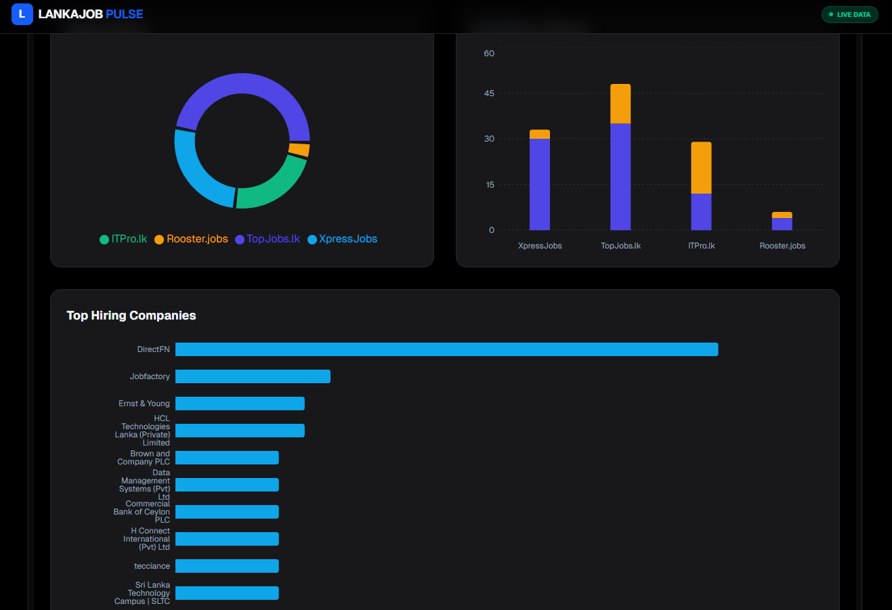
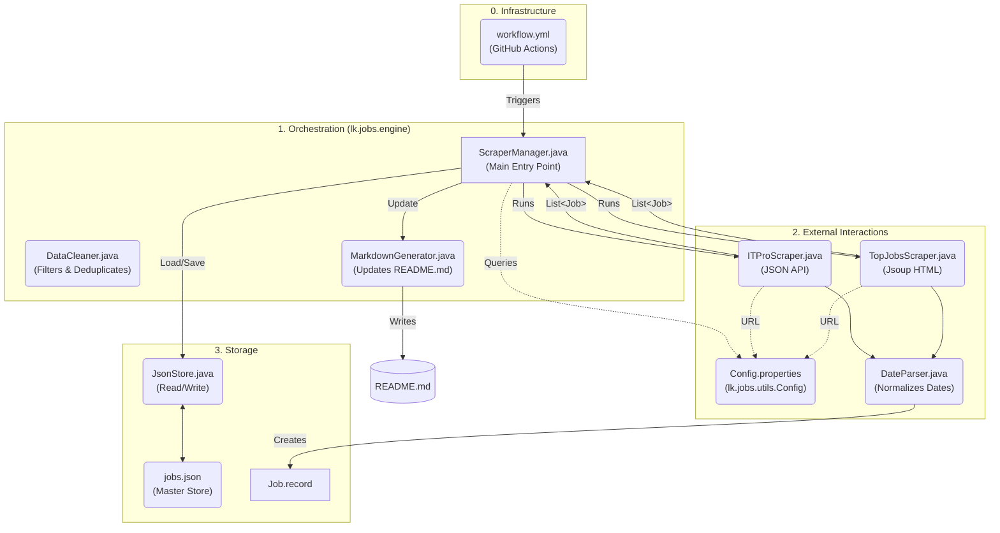

# 🇱🇰 Sri Lanka Software Engineering Jobs | 2026 Tracker [](https://t.me/SL_Software_Jobs)
Looking for software engineering jobs in Sri Lanka? This tracker updates daily with intern, junior, and senior IT roles across Colombo and beyond
Automated Software Engineering Job Tracker for Sri Lanka. Scrapes and categorizes Intern, Associate, and SE roles daily using Java (Jsoup) and GitHub Actions.

> [!TIP]
> **Help keep this project alive!** If this tool helped you find a lead today, please [**Star ⭐ the repo**](https://github.com/Senadeera-NK/sri-lanka-software-jobs). It’s how I measure the impact on our dev community! 🇱🇰

> [!IMPORTANT]
> **Automatic Staleness Purge:** The engine automatically removes listings older than **14 days**, ensuring the feed stays relevant and high-signal.

> **Live Analytics & Daily Software Job Tracker for Sri Lanka**

[📊 View Live Dashboard](https://sri-lanka-software-jobs.vercel.app/)

 
*Click the link above to see real-time trends, seniority distribution, and top hiring companies.*

## 📊 Current Job Openings
> 🟢 **Last Updated:** November 23,9:52 PM (Just now)  | **Total Jobs Found:** 115

### 🎓 Internships & Trainees  (9)

| Title | Company | Level  | Posted | Source |
| :--- | :--- | :--- | :--- | :--- |
| [Intern - Product Development (1)](https://www.topjobs.lk/employer/JobAdvertismentServlet?ac=0000000094&jc=0001574136&ec=0000000111) | MAS Holdings | Intern | 3&nbsp;days&nbsp;ago | TopJobs.lk |
| [Full Stack Developer Intern](https://www.topjobs.lk/employer/JobAdvertismentServlet?ac=DEFZZZ&jc=0001573591&ec=DEFZZZ) | Medcube USA | Intern | 4&nbsp;days&nbsp;ago | TopJobs.lk |
| [Intern – Quality Assurance (QA) \| Wattala](https://xpress.jobs/jobs/view/352300) | Toyota Lanka | Intern | 6&nbsp;days&nbsp;ago | XpressJobs |
| [Intern - Software Development](https://www.topjobs.lk/employer/JobAdvertismentServlet?ac=DEFZZZ&jc=0001571856&ec=DEFZZZ) | Arrogance Technologies (Pvt) Ltd | Intern | 7&nbsp;days&nbsp;ago | TopJobs.lk |
| [Intern - Data Protection & Privacy](https://www.topjobs.lk/employer/JobAdvertismentServlet?ac=DEFZZZ&jc=0001570591&ec=DEFZZZ) | ?Mercantile Investments and Finance PLC | Intern | 11&nbsp;days&nbsp;ago | TopJobs.lk |
| [Intern - Software Engineer](https://www.topjobs.lk/employer/JobAdvertismentServlet?ac=DEFZZZ&jc=0001570199&ec=DEFZZZ) | Akhtari Trades (Pvt) Ltd | Intern | 12&nbsp;days&nbsp;ago | TopJobs.lk |
| [Intern Full Stack Engineer (.Net and Angular) - Colombo 3](https://www.topjobs.lk/employer/JobAdvertismentServlet?ac=DEFZZZ&jc=0001569240&ec=DEFZZZ) | MedCubeUSA | Intern | 14&nbsp;days&nbsp;ago | TopJobs.lk |
| [Full Stack Developer - Internship \| Junior Level (Night Shi...](https://www.topjobs.lk/employer/JobAdvertismentServlet?ac=DEFZZZ&jc=0001569235&ec=DEFZZZ) | MedCubeUSA | Intern | 14&nbsp;days&nbsp;ago | TopJobs.lk |
| [Trainee / Intern - Software Developer (Work from Home)](https://www.topjobs.lk/employer/JobAdvertismentServlet?ac=DEFZZZ&jc=0001569012&ec=DEFZZZ) | Hightechx Software Solutions (PVT) Ltd | Intern | 14&nbsp;days&nbsp;ago | TopJobs.lk |

---

### 💻 Associate & Junior/SE Roles  (62)

| Title | Company | Level  | Posted | Source |
| :--- | :--- | :--- | :--- | :--- |
| [QA Engineer](https://www.topjobs.lk/employer/JobAdvertismentServlet?ac=DEFZZZ&jc=0001571805&ec=DEFZZZ) | InEight Sri Lanka | Junior/SE | 21&nbsp;hours&nbsp;ago | TopJobs.lk |
| [Software Developer - AI & Business Automation](https://www.topjobs.lk/employer/JobAdvertismentServlet?ac=DEFZZZ&jc=0001572349&ec=DEFZZZ) | Company Name Withheld | Junior/SE | 21&nbsp;hours&nbsp;ago | TopJobs.lk |
| [Data Engineer](https://www.topjobs.lk/employer/JobAdvertismentServlet?ac=DEFZZZ&jc=0001572536&ec=DEFZZZ) | ORYSYS Limited | Junior/SE | 21&nbsp;hours&nbsp;ago | TopJobs.lk |
| [Java Engineer (VA Fixing)](https://www.topjobs.lk/employer/JobAdvertismentServlet?ac=DEFZZZ&jc=0001573209&ec=DEFZZZ) | ORYSYS Limited | Junior/SE | 21&nbsp;hours&nbsp;ago | TopJobs.lk |
| [E-Commerce Executive \| System Implementation Engineer](https://www.topjobs.lk/employer/JobAdvertismentServlet?ac=DEFZZZ&jc=0001570753&ec=DEFZZZ) | Dipro IT | Junior/SE | 21&nbsp;hours&nbsp;ago | TopJobs.lk |
| [Software Engineer](https://www.topjobs.lk/employer/JobAdvertismentServlet?ac=DEFZZZ&jc=0001574727&ec=DEFZZZ) | HDFC Bank | Junior/SE | 21&nbsp;hours&nbsp;ago | TopJobs.lk |
| [Risk & Governance Engineer](https://www.topjobs.lk/employer/JobAdvertismentServlet?ac=DEFZZZ&jc=0001574535&ec=DEFZZZ) | Innobot Health | Junior/SE | 21&nbsp;hours&nbsp;ago | TopJobs.lk |
| [Quality Assurance Engineer](https://xpress.jobs/jobs/view/353199) | Davton Limited | Junior/SE | 3&nbsp;days&nbsp;ago | XpressJobs |
| [Associate Quality Assurance Engineer](https://xpress.jobs/jobs/view/353200) | Davton Limited | Associate | 3&nbsp;days&nbsp;ago | XpressJobs |
| [Graduate Engineer Analyst - Infrastructure Services (Data Ce...](https://xpress.jobs/jobs/view/353327) | HCL Technologies Lanka (Private) Limited | Junior/SE | 3&nbsp;days&nbsp;ago | XpressJobs |
| [Graduate Engineering (Fresh Graduates)](https://xpress.jobs/jobs/view/353458) | HCL Technologies Lanka (Private) Limited | Junior/SE | 3&nbsp;days&nbsp;ago | XpressJobs |
| [SME - RedHat Cluster, Ansible, Kubernetes, Microsoft Azure \| Colombo](https://xpress.jobs/jobs/view/353614) | HCL Technologies Lanka (Private) Limited | Junior/SE | 3&nbsp;days&nbsp;ago | XpressJobs |
| [Trainee Quality Assurance Engineer](https://xpress.jobs/jobs/view/353648) | 3CS | Associate | 3&nbsp;days&nbsp;ago | XpressJobs |
| [Junior / Trainee DevOps Engineer](https://xpress.jobs/jobs/view/353651) | 3CS | Associate | 3&nbsp;days&nbsp;ago | XpressJobs |
| [Instructor (Temporary) - Department of Computer Science, Fac...](https://xpress.jobs/jobs/view/353695) | Sri Lanka Institute of Information Technology (SLIIT) | Junior/SE | 3&nbsp;days&nbsp;ago | XpressJobs |
| [AI & Automation Associate](https://xpress.jobs/jobs/view/354056) | Beyond Real Estate | Associate | 3&nbsp;days&nbsp;ago | XpressJobs |
| [Facility Engineer GIT](https://xpress.jobs/jobs/view/354337) | HCL Technologies Lanka (Private) Limited | Junior/SE | 3&nbsp;days&nbsp;ago | XpressJobs |
| [Linux Systems Administrator (DevOps)](https://xpress.jobs/jobs/view/354564) | Elevex Technologies Pvt Ltd | Junior/SE | 3&nbsp;days&nbsp;ago | XpressJobs |
| [Associate Software Engineer - Department of IT](https://xpress.jobs/jobs/view/354771) | Sri Lanka Institute of Information Technology (SLIIT) | Associate | 3&nbsp;days&nbsp;ago | XpressJobs |
| [Solution Engineer - Infrastructure Automation and Al (Depart...](https://xpress.jobs/jobs/view/354774) | Sri Lanka Institute of Information Technology (SLIIT) | Junior/SE | 3&nbsp;days&nbsp;ago | XpressJobs |
| [Executive - Server Infrastructure & System Software](https://xpress.jobs/jobs/view/355111) | SINGER (Sri Lanka) PLC | Junior/SE | 3&nbsp;days&nbsp;ago | XpressJobs |
| [Software Developer](https://xpress.jobs/jobs/view/355115) | Assist Island Pvt Ltd | Junior/SE | 3&nbsp;days&nbsp;ago | XpressJobs |
| [Trainee - Data Analytics](https://xpress.jobs/jobs/view/355576) | Credit Information Bureau of Sri Lanka | Associate | 3&nbsp;days&nbsp;ago | XpressJobs |
| [Trainee - Information Security, Risk and Compliance](https://xpress.jobs/jobs/view/355577) | Credit Information Bureau of Sri Lanka | Associate | 3&nbsp;days&nbsp;ago | XpressJobs |
| [Risk and Governance Engineer](https://xpress.jobs/jobs/view/355625) | Innobot (Pvt) Ltd | Junior/SE | 3&nbsp;days&nbsp;ago | XpressJobs |
| [Information Security Engineer (1)](https://www.topjobs.lk/employer/JobAdvertismentServlet?ac=0000000271&jc=0001539697&ec=0000000350) | CMS (Pvt) Ltd | Junior/SE | 3&nbsp;days&nbsp;ago | TopJobs.lk |
| [Chief Information Security Officer - (CISO)](https://www.topjobs.lk/employer/JobAdvertismentServlet?ac=DEFZZZ&jc=0001574157&ec=DEFZZZ) | Lanka Electricity Company (Private) Limited | Junior/SE | 3&nbsp;days&nbsp;ago | TopJobs.lk |
| [Associate Software Engineer - Full Stack](https://www.topjobs.lk/employer/JobAdvertismentServlet?ac=DEFZZZ&jc=0001573771&ec=DEFZZZ) | Dockyard Total Solutions (Pvt) Ltd | Associate | 3&nbsp;days&nbsp;ago | TopJobs.lk |
| [Software Engineer](https://www.topjobs.lk/employer/JobAdvertismentServlet?ac=DEFZZZ&jc=0001573547&ec=DEFZZZ) | MBSL Insurance Co. Ltd | Junior/SE | 4&nbsp;days&nbsp;ago | TopJobs.lk |
| [Associate Project Coordinator - Agile (Software Development)](https://www.topjobs.lk/employer/JobAdvertismentServlet?ac=DEFZZZ&jc=0001573302&ec=DEFZZZ) | Company Name Withheld | Associate | 4&nbsp;days&nbsp;ago | TopJobs.lk |
| [Associate Software Engineer - AI \| BI](https://www.topjobs.lk/employer/JobAdvertismentServlet?ac=DEFZZZ&jc=0001573301&ec=DEFZZZ) | Company Name Withheld | Associate | 4&nbsp;days&nbsp;ago | TopJobs.lk |
| [Full Stack Developer](https://www.topjobs.lk/employer/JobAdvertismentServlet?ac=DEFZZZ&jc=0001573137&ec=DEFZZZ) | Axis Technologies (Pvt) Ltd | Junior/SE | 4&nbsp;days&nbsp;ago | TopJobs.lk |
| [Application Developer - Night Shift](https://www.topjobs.lk/employer/JobAdvertismentServlet?ac=DEFZZZ&jc=0001573056&ec=DEFZZZ) | Legacy Health (Pvt) Ltd | Junior/SE | 5&nbsp;days&nbsp;ago | TopJobs.lk |
| [Associate Technical Lead \| Technical Lead - Java & React](https://www.topjobs.lk/employer/JobAdvertismentServlet?ac=0000000494&jc=0001572541&ec=0000000666) | Acentura Pvt Ltd | Associate | 5&nbsp;days&nbsp;ago | TopJobs.lk |
| [Experienced AI Technology Freelancer](https://www.topjobs.lk/employer/JobAdvertismentServlet?ac=DEFZZZ&jc=0001572447&ec=DEFZZZ) | Company Name Withheld | Junior/SE | 6&nbsp;days&nbsp;ago | TopJobs.lk |
| [AI & Automation Specialist](https://www.topjobs.lk/employer/JobAdvertismentServlet?ac=DEFZZZ&jc=0001572253&ec=DEFZZZ) | Livest (Pvt) Ltd | Junior/SE | 6&nbsp;days&nbsp;ago | TopJobs.lk |
| [Trainee - Data Protection Officer](https://xpress.jobs/jobs/view/351120) | LOLC Holdings PLC | Associate | 6&nbsp;days&nbsp;ago | XpressJobs |
| [IT Executive – Data & SQL Development](https://xpress.jobs/jobs/view/351324) | Singer Finance (Lanka) PLC | Junior/SE | 6&nbsp;days&nbsp;ago | XpressJobs |
| [Software Engineer / ABAP Developer](https://xpress.jobs/jobs/view/351894) | Lanka Tiles PLC | Junior/SE | 6&nbsp;days&nbsp;ago | XpressJobs |
| [SericeNow Developer](https://xpress.jobs/jobs/view/352334) | HCL Technologies Lanka (Private) Limited | Junior/SE | 6&nbsp;days&nbsp;ago | XpressJobs |
| [Devops & IT Infrastucture Engineer \| Nawam Mawatha, Colombo 02](https://xpress.jobs/jobs/view/352496) | Victory Company (Igaming BPO) | Junior/SE | 6&nbsp;days&nbsp;ago | XpressJobs |
| [Data Governance Officer](https://xpress.jobs/jobs/view/352577) | Brown and Company PLC | Junior/SE | 6&nbsp;days&nbsp;ago | XpressJobs |
| [Engineer - OSS/BSS](https://xpress.jobs/jobs/view/352631) | Mobitel (Pvt) Ltd | Junior/SE | 6&nbsp;days&nbsp;ago | XpressJobs |
| [Software Architect \| Colombo](https://xpress.jobs/jobs/view/352939) | Mavip Infotech | Junior/SE | 6&nbsp;days&nbsp;ago | XpressJobs |
| [Document and Quality Controller (Contract Basis)](https://xpress.jobs/jobs/view/352628) | BOC Management and Support Services (Pvt) Ltd., | Junior/SE | 6&nbsp;days&nbsp;ago | XpressJobs |
| [AI & Automation Associate](https://www.topjobs.lk/employer/JobAdvertismentServlet?ac=DEFZZZ&jc=0001571868&ec=DEFZZZ) | Beyond EQT Real Estate Development Ltd | Associate | 7&nbsp;days&nbsp;ago | TopJobs.lk |
| [Quality Assurance Trainee](https://www.topjobs.lk/employer/JobAdvertismentServlet?ac=DEFZZZ&jc=0001571766&ec=DEFZZZ) | Inqbaytor Pte Ltd | Associate | 7&nbsp;days&nbsp;ago | TopJobs.lk |
| [Backend Software Engineer](https://www.topjobs.lk/employer/JobAdvertismentServlet?ac=DEFZZZ&jc=0001571048&ec=DEFZZZ) | Hexacorp SL (Private) Limited | Junior/SE | 10&nbsp;days&nbsp;ago | TopJobs.lk |
| [Platform & Integration Engineer (AUS Calendar - AUS Shift) (1)](https://www.topjobs.lk/employer/JobAdvertismentServlet?ac=0000000064&jc=0001571280&ec=0000000445) | H Connect International (Pvt) Ltd | Junior/SE | 10&nbsp;days&nbsp;ago | TopJobs.lk |
| [Document and Quality Controller (Contract Basis)](https://www.topjobs.lk/employer/JobAdvertismentServlet?ac=DEFZZZ&jc=0001570976&ec=DEFZZZ) | BOC IT Solutions (Pvt) Ltd | Junior/SE | 10&nbsp;days&nbsp;ago | TopJobs.lk |
| [Data & Analytics Engineer (AUS Calendar - AUS Shift) (1)](https://www.topjobs.lk/employer/JobAdvertismentServlet?ac=0000000064&jc=0001571296&ec=0000000445) | H Connect International (Pvt) Ltd | Junior/SE | 10&nbsp;days&nbsp;ago | TopJobs.lk |
| [Automation Engineer (AUS Calendar - AUS Shift) (1)](https://www.topjobs.lk/employer/JobAdvertismentServlet?ac=0000000064&jc=0001571285&ec=0000000445) | H Connect International (Pvt) Ltd | Junior/SE | 10&nbsp;days&nbsp;ago | TopJobs.lk |
| [DevOps & Infrastructure Specialist - Colombo 3](https://www.topjobs.lk/employer/JobAdvertismentServlet?ac=DEFZZZ&jc=0001570652&ec=DEFZZZ) | XPAND | Junior/SE | 11&nbsp;days&nbsp;ago | TopJobs.lk |
| [Data Analyst](https://www.topjobs.lk/employer/JobAdvertismentServlet?ac=DEFZZZ&jc=0001570564&ec=DEFZZZ) | Hettigoda Industries (Siddhalepa) | Junior/SE | 11&nbsp;days&nbsp;ago | TopJobs.lk |
| [Associate Engineer - Agentic AI (1)](https://www.topjobs.lk/employer/JobAdvertismentServlet?ac=0000000201&jc=0001569685&ec=0000000241) | D.Samson & Sons Ltd | Associate | 13&nbsp;days&nbsp;ago | TopJobs.lk |
| [IT Executive / Zoho Developer (1)](https://www.topjobs.lk/employer/JobAdvertismentServlet?ac=0000000390&jc=0001569564&ec=0000000513) | KDG GLOBAL | Junior/SE | 13&nbsp;days&nbsp;ago | TopJobs.lk |
| [Software Engineer JAVA (1)](https://www.topjobs.lk/employer/JobAdvertismentServlet?ac=0000000492&jc=0001569511&ec=0000000661) | DirectFN | Junior/SE | 13&nbsp;days&nbsp;ago | TopJobs.lk |
| [Junior Software Trainee](https://www.topjobs.lk/employer/JobAdvertismentServlet?ac=DEFZZZ&jc=0001569485&ec=DEFZZZ) | Webappclouds (Pvt) Ltd | Associate | 13&nbsp;days&nbsp;ago | TopJobs.lk |
| [IT Helpdesk Engineer - Male (20)](https://www.topjobs.lk/employer/JobAdvertismentServlet?ac=0000000419&jc=0001569219&ec=0000000552) | Micronet Global Services (Pvt) Ltd | Junior/SE | 14&nbsp;days&nbsp;ago | TopJobs.lk |
| [Database Administrator - DBA](https://www.topjobs.lk/employer/JobAdvertismentServlet?ac=DEFZZZ&jc=0001569076&ec=DEFZZZ) | Onsys Technologies | Junior/SE | 14&nbsp;days&nbsp;ago | TopJobs.lk |
| [Security and Compliance Specialist](https://rooster.jobs/jobs/520086) | Nextjob | Junior/SE | 14&nbsp;days&nbsp;ago | Rooster.jobs |
| [Security and Compliance Specialist (Part-time & Hybrid)](https://rooster.jobs/jobs/520086) | Nextjob | Junior/SE | 14&nbsp;days&nbsp;ago | Rooster.jobs |

---

### 🚀 Senior & Lead Roles  (44)

| Title | Company | Level  | Posted | Source |
| :--- | :--- | :--- | :--- | :--- |
| [Tech Lead - AI](https://www.topjobs.lk/employer/JobAdvertismentServlet?ac=DEFZZZ&jc=0001572539&ec=DEFZZZ) | ORYSYS Limited | Senior | 21&nbsp;hours&nbsp;ago | TopJobs.lk |
| [Senior Data Engineer](https://www.topjobs.lk/employer/JobAdvertismentServlet?ac=DEFZZZ&jc=0001572537&ec=DEFZZZ) | ORYSYS Limited | Senior | 21&nbsp;hours&nbsp;ago | TopJobs.lk |
| [Senior Java Engineer (VA Fixing)](https://www.topjobs.lk/employer/JobAdvertismentServlet?ac=DEFZZZ&jc=0001573194&ec=DEFZZZ) | ORYSYS Limited | Senior | 21&nbsp;hours&nbsp;ago | TopJobs.lk |
| [Senior QA Engineer](https://www.topjobs.lk/employer/JobAdvertismentServlet?ac=DEFZZZ&jc=0001574198&ec=DEFZZZ) | Company Name Withheld | Senior | 21&nbsp;hours&nbsp;ago | TopJobs.lk |
| [Senior Database Administrator (1)](https://www.topjobs.lk/employer/JobAdvertismentServlet?ac=0000000492&jc=0001574377&ec=0000000661) | DirectFN | Senior | 2&nbsp;days&nbsp;ago | TopJobs.lk |
| [Principal Engineer cum Team Lead (AI, Software)](https://xpress.jobs/jobs/view/353579) | PBA Systems Pte Ltd | Senior | 3&nbsp;days&nbsp;ago | XpressJobs |
| [Senior Administrator - Security Analysis - SIEM](https://xpress.jobs/jobs/view/353861) | HCL Technologies Lanka (Private) Limited | Senior | 3&nbsp;days&nbsp;ago | XpressJobs |
| [Senior Security Engineer](https://xpress.jobs/jobs/view/348206) | TGT Global | Senior | 3&nbsp;days&nbsp;ago | XpressJobs |
| [Senior Test Automation Engineer - Manual & Automation \| Hybrid](https://xpress.jobs/jobs/view/354203) | vTesters (Pvt) Ltd | Senior | 3&nbsp;days&nbsp;ago | XpressJobs |
| [Senior Automation Engineer](https://xpress.jobs/jobs/view/354594) | Mitra Innovation (Pvt) Ltd | Senior | 3&nbsp;days&nbsp;ago | XpressJobs |
| [Senior SQL and SSRS Developer](https://xpress.jobs/jobs/view/354845) | KriyaGo | Senior | 3&nbsp;days&nbsp;ago | XpressJobs |
| [Technical Lead (AI, Software)](https://xpress.jobs/jobs/view/355038) | PBA Systems Pte Ltd | Senior | 3&nbsp;days&nbsp;ago | XpressJobs |
| [Senior Machine Learning Engineer](https://xpress.jobs/jobs/view/355049) | AIClub | Senior | 3&nbsp;days&nbsp;ago | XpressJobs |
| [Senior Administrator - Azure DevOps](https://xpress.jobs/jobs/view/355300) | HCL Technologies Lanka (Private) Limited | Senior | 3&nbsp;days&nbsp;ago | XpressJobs |
| [Senior Engineer - DevOps](https://xpress.jobs/jobs/view/355533) | Dialog Axiata PLC | Senior | 3&nbsp;days&nbsp;ago | XpressJobs |
| [Technical Lead - Software Engineering and Devops](https://xpress.jobs/jobs/view/355555) | Hayleys Advantis Limited | Senior | 3&nbsp;days&nbsp;ago | XpressJobs |
| [Senior Specialist - Cyber Security](https://xpress.jobs/jobs/view/355569) | HCL Technologies Lanka (Private) Limited | Senior | 3&nbsp;days&nbsp;ago | XpressJobs |
| [Senior Devops Engineer](https://xpress.jobs/jobs/view/355139) | Mobitel (Pvt) Ltd | Senior | 3&nbsp;days&nbsp;ago | XpressJobs |
| [Senior Application Security Engineer (1)](https://www.topjobs.lk/employer/JobAdvertismentServlet?ac=0000000271&jc=0001562903&ec=0000000350) | CMS (Pvt) Ltd | Senior | 3&nbsp;days&nbsp;ago | TopJobs.lk |
| [Technical Lead & Solution Architect - Papua New Guinea](https://www.topjobs.lk/employer/JobAdvertismentServlet?ac=DEFZZZ&jc=0001574047&ec=DEFZZZ) | Mega Global Resources (Pvt) Ltd | Senior | 3&nbsp;days&nbsp;ago | TopJobs.lk |
| [Technical Lead - Software Engineering and Devops](https://www.topjobs.lk/employer/JobAdvertismentServlet?ac=0000000377&jc=0001573846&ec=0000000495) | Hayleys Group | Senior | 3&nbsp;days&nbsp;ago | TopJobs.lk |
| [Senior Data Analyst](https://www.topjobs.lk/employer/JobAdvertismentServlet?ac=DEFZZZ&jc=0001573773&ec=DEFZZZ) | Nelna Farm | Senior | 3&nbsp;days&nbsp;ago | TopJobs.lk |
| [Android Tech Lead](https://www.topjobs.lk/employer/JobAdvertismentServlet?ac=DEFZZZ&jc=0001573395&ec=DEFZZZ) | Fortunaglobal (Pvt) Limited | Senior | 4&nbsp;days&nbsp;ago | TopJobs.lk |
| [Senior Executive - Information Security](https://www.topjobs.lk/employer/JobAdvertismentServlet?ac=DEFZZZ&jc=0001572881&ec=DEFZZZ) | Mercantile Investments and Finance PLC | Senior | 5&nbsp;days&nbsp;ago | TopJobs.lk |
| [Senior Quality Assurance Engineer (1)](https://www.topjobs.lk/employer/JobAdvertismentServlet?ac=0000000280&jc=0001572035&ec=0000000510) | Expolanka Freight (Pvt) Ltd | Senior | 6&nbsp;days&nbsp;ago | TopJobs.lk |
| [Senior MERN Stack Developer](https://xpress.jobs/jobs/view/350678) | GALILEO VENTURES (PVT) LTD | Senior | 6&nbsp;days&nbsp;ago | XpressJobs |
| [Senior Specialist - Symantec Email Security & Endpoint Security](https://xpress.jobs/jobs/view/351907) | HCL Technologies Lanka (Private) Limited | Senior | 6&nbsp;days&nbsp;ago | XpressJobs |
| [Senior Developer - SAP ABAP S4 Hana](https://xpress.jobs/jobs/view/351908) | HCL Technologies Lanka (Private) Limited | Senior | 6&nbsp;days&nbsp;ago | XpressJobs |
| [Automation Test Lead - Selenium / Playwright](https://xpress.jobs/jobs/view/351909) | HCL Technologies Lanka (Private) Limited | Senior | 6&nbsp;days&nbsp;ago | XpressJobs |
| [Senior Java Architect \| Colombo](https://xpress.jobs/jobs/view/352037) | YI CAN PTE. LTD. | Senior | 6&nbsp;days&nbsp;ago | XpressJobs |
| [Senior Administrator – CheckPoint PPC (Software) & Cloud Security](https://xpress.jobs/jobs/view/352859) | HCL Technologies Lanka (Private) Limited | Senior | 6&nbsp;days&nbsp;ago | XpressJobs |
| [Senior Administrator - Azure DevOps & Terraform](https://xpress.jobs/jobs/view/352861) | HCL Technologies Lanka (Private) Limited | Senior | 6&nbsp;days&nbsp;ago | XpressJobs |
| [Senior Administrator - Azure DevOps & Terraform \| Hybrid](https://xpress.jobs/jobs/view/352862) | HCL Technologies Lanka (Private) Limited | Senior | 6&nbsp;days&nbsp;ago | XpressJobs |
| [Senior Analyst – IAM Access Management Engineer](https://xpress.jobs/jobs/view/352864) | HCL Technologies Lanka (Private) Limited | Senior | 6&nbsp;days&nbsp;ago | XpressJobs |
| [Senior Administrator – Azure, Cloud Security & Palo Alto Firewall](https://xpress.jobs/jobs/view/352867) | HCL Technologies Lanka (Private) Limited | Senior | 6&nbsp;days&nbsp;ago | XpressJobs |
| [Senior Full Stack Software Engineer](https://www.topjobs.lk/employer/JobAdvertismentServlet?ac=DEFZZZ&jc=0001571133&ec=DEFZZZ) | XPAND | Senior | 10&nbsp;days&nbsp;ago | TopJobs.lk |
| [Teach Lead - Machine Learning (ML)](https://www.topjobs.lk/employer/JobAdvertismentServlet?ac=DEFZZZ&jc=0001566151&ec=DEFZZZ) | ORYSYS Limited | Senior | 10&nbsp;days&nbsp;ago | TopJobs.lk |
| [Tech Lead - AI Solutions](https://www.topjobs.lk/employer/JobAdvertismentServlet?ac=DEFZZZ&jc=0001566076&ec=DEFZZZ) | ORYSYS Limited | Senior | 10&nbsp;days&nbsp;ago | TopJobs.lk |
| [Engineer \| Senior Engineer - Data Engineering](https://www.topjobs.lk/employer/JobAdvertismentServlet?ac=0000000494&jc=0001570562&ec=0000000666) | Acentura Pvt Ltd | Senior | 11&nbsp;days&nbsp;ago | TopJobs.lk |
| [Tech Lead - Senior Backend Developer (Python)](https://www.topjobs.lk/employer/JobAdvertismentServlet?ac=DEFZZZ&jc=0001570397&ec=DEFZZZ) | Seren IT Services | Senior | 11&nbsp;days&nbsp;ago | TopJobs.lk |
| [Senior Software Engineer - . NET (1)](https://www.topjobs.lk/employer/JobAdvertismentServlet?ac=0000000375&jc=0001570367&ec=0000000492) | Jobfactory | Senior | 12&nbsp;days&nbsp;ago | TopJobs.lk |
| [Backend Technical Lead (Node/TypeScript) - REF8600](https://rooster.jobs/jobs/520096) | Creative Software | Senior | 12&nbsp;days&nbsp;ago | Rooster.jobs |
| [Senior Full-Stack Software Engineer](https://www.topjobs.lk/employer/JobAdvertismentServlet?ac=DEFZZZ&jc=0001569561&ec=DEFZZZ) | Avagance Limited | Senior | 13&nbsp;days&nbsp;ago | TopJobs.lk |
| [Senior EDI Engineer (1)](https://www.topjobs.lk/employer/JobAdvertismentServlet?ac=0000000280&jc=0001569016&ec=0000000510) | Expolanka Freight (Pvt) Ltd | Senior | 14&nbsp;days&nbsp;ago | TopJobs.lk |

---


## 🛠️ How it Works
1. **Engine:** A Java 21 console application using **Jsoup**.
2. **Sources:** Currently scraping `ITPro.lk` and  `TopJobs`. Support for and `Rooster.jobs` is under development (Contributors welcome!)
3. **Automation:** Runs every 12 hours via **GitHub Actions**.
4. **Storage:** Updates this `README.md` and a `jobs.json` file automatically.

<details>
<summary><b>📐 View High-Level Architecture Diagram</b></summary>
    


</details>

<details>
<summary><b>📂 View Project Structure</b></summary>

```text
src/main/java/lk/jobs/
├── engine/           # Logic for sorting, cleaning, and README updates
├── model/            # Data models (Job Record)
├── scrapers/         # Individual site scrapers
└── utils/            # JSON and Date parsing utilities
```
</details>

## 🚀 Usage
If you want to run the scraper locally:
1. Clone the repo.
2. Ensure you have **JDK 21** and **Maven** installed.
3. Run: mvn clean compile exec:java -Dexec.mainClass="lk.jobs.engine.ScraperManager"

## 🤝 Contributing
Contributions are what make the open-source community such an amazing place to learn, inspire, and create.
Any contributions you make are **greatly appreciated**.

* **Found a bug?** Open an [Issue](https://github.com/Senadeera-NK/sl-software-engineering-jobs/issues).
* **Want to add a new site?** Check out our [Contributing Guidelines](CONTRIBUTING.md) to see how to implement a new scraper.
* **Missing a job?** Feel free to submit a Pull Request to manually update the table!
